# Business Analysis Report

Comprehensive analysis of Yelp business data, focusing on merchant distribution, ratings, categories, and customer sentiment across the U.S. market.

## Executive Summary

This analysis examines **Yelp business patterns and market dynamics** to answer critical business questions about merchant concentration, category trends, and customer satisfaction drivers across multiple geographic and business dimensions.

### Core Questions
- **Which merchant chains dominate the market?** And what are their competitive dynamics?
- **How is the market geographically distributed?** Which cities and states lead?
- **What business categories drive engagement?** Which categories co-occur and create synergies?
- **Which restaurants lead in customer satisfaction?** And which show the most potential for improvement?
- **How polarized are customer opinions?** Which businesses need consistency improvements?

### Key Findings
✅ **Market Concentration**: Starbucks (724 locations) and McDonald's (703 locations) lead; fast food and convenience retail dominate  
✅ **Geographic Hubs**: Philadelphia leads with 14,569 merchants; top 5 states (PA, FL, TN, IN, MO) represent major markets  
✅ **Category Distribution**: 1,311 diverse categories; Restaurants (52,268), Food (27,781), and Shopping (24,395) dominate  
✅ **Cuisine Trends**: American restaurants (13,066 locations, 1.7M reviews) drive engagement; Mediterranean and Thai maintain higher ratings  
✅ **Satisfaction Gaps**: Top performers reach 4.0+ ⭐ (Reading Terminal Market: 4,014 five-star reviews); polarizing businesses show 1.9-1.94 σ  
✅ **Turnaround Opportunity**: 200+ businesses show 3.5+ star improvements; service-oriented businesses lead recovery

---

## Table of Contents

1. [Business Hypothesis](#business-hypothesis)
2. [Data Sources](#data-sources)
3. [Methodology](#methodology)
4. [Analyses Overview](#analyses-overview)
5. [Key Findings](#key-findings)
6. [Analysis Details](#analysis-details)
7. [Files & References](#files--references)

---

## Business Hypothesis

### Problem Statement
E-commerce and retail executives need to understand market dynamics for strategic decision-making:

1. **Market Entry Strategy** — Which cities/states offer the best opportunities?
2. **Category Strategy** — What business categories show strongest performance?
3. **Competitive Positioning** — How do successful merchants outperform peers?
4. **Risk Management** — Which businesses are underperforming and need intervention?
5. **Portfolio Optimization** — What category combinations create business synergies?

### Hypotheses to Test

**H1: Market Concentration Hypothesis**
- Large merchant chains (Starbucks, McDonald's) dominate through scale
- Market access follows geographic clusters in major metropolitan areas
- Small, specialized merchants maintain niches despite competitive pressure

**H2: Category Performance Hypothesis**
- Certain categories (Restaurants, Food) drive disproportionate engagement
- Co-occurring categories create synergy (Bars + Nightlife + Restaurants)
- Specialized cuisines maintain higher ratings despite lower volume

**H3: Customer Satisfaction Hypothesis**
- Service businesses show strongest improvement potential (turnarounds)
- Automotive/Dental categories polarize more than food/entertainment
- Geographic location correlates with baseline satisfaction levels

---

## Methodology

### Analysis Framework

**Phase 1: Market Structure Analysis**
- Merchant chain frequency analysis (top merchants)
- Geographic distribution (cities, states)
- Category diversity and concentration metrics

**Phase 2: Performance Analysis**
- Rating distributions by merchant, category, cuisine
- Customer sentiment analysis (high vs. low ratings)
- Cuisine-specific performance metrics

**Phase 3: Business Dynamics**
- Merchant improvement tracking (turnarounds vs. declines)
- Category co-occurrence patterns (synergy analysis)
- Customer opinion polarization (rating standard deviation)

### Key Metrics Calculated

| Metric | Definition |
|--------|-----------|
| Merchant Frequency | Number of locations per merchant chain |
| Geographic Distribution | Merchant/review count by city/state |
| Average Rating | Mean star rating by category/cuisine |
| Review Volume | Total reviews per business/category |
| Rating Spread | 1-5 star distribution percentages |
| Turnaround Score | Recent rating vs. historical rating improvement |
| Polarization | Standard deviation of rating distribution |
| Co-occurrence | Frequency of category pairs in merchant profiles |

### Data Processing Pipeline

1. **Aggregation**: Group reviews by business, category, and city
2. **Standardization**: Normalize geographic names and category labels
3. **Calculation**: Compute metrics (means, distributions, frequencies)
4. **Ranking**: Sort by metric relevance (top performers, outliers)
5. **Visualization**: Generate charts and summary tables

---

## Analyses Overview

### Analysis 1-3: Market Structure Analysis
Understand how merchants and categories distribute geographically

### Analysis 4-7: Merchant & Cuisine Performance
Identify high-performers and customer satisfaction drivers

### Analysis 8-10: Cuisine Analysis & Rating Distribution
Explore cuisine-specific engagement and satisfaction patterns

### Analysis 11-13: Business Dynamics
Detect improvement opportunities, category synergies, and polarization

---

## Key Findings

### Finding 1: Fast Food and Convenience Retail Dominate Merchant Distribution

**Top Merchant Chains**
| Merchant | Locations | Avg Rating |
|----------|-----------|-----------|
| Starbucks | 724 | 3.13 ⭐ |
| McDonald's | 703 | 2.38 ⭐ |
| Dunkin' | 351 | 3.18 ⭐ |
| Subway | 312 | 3.10 ⭐ |
| Taco Bell | 299 | 2.40 ⭐ |
| CVS Pharmacy | 285 | 2.61 ⭐ |
| Walgreens | 283 | 2.84 ⭐ |

**Interpretation**:
- Coffee chains (Starbucks, Dunkin') lead with volume + community presence
- Fast food (McDonald's, Subway, Taco Bell) shows strong presence but lower ratings (2.4 ⭐)
- Convenience retail (CVS, Walgreens) maintain consistent but moderate ratings (2.6-2.8 ⭐)
- Scale leaders ≠ satisfaction leaders; Wawa (3.32 ⭐) and Chick-fil-A (3.38+ ⭐) show premium positioning

### Finding 2: Geographic Market Concentration in 5 Major States

**Top Cities & States**
| City | State | Merchants | Market Share |
|------|-------|-----------|-------------|
| Philadelphia | PA | 14,569 | Highest urban density |
| Tampa | FL | 14,491 | Second largest |
| Tucson | AZ | 9,250 | Tier-2 market |
| Nashville | TN | 8,385 | Emerging hub |
| Indianapolis | IN | 7,540 | Regional center |

**State-Level Concentration**
| State | Merchants | % of Dataset |
|-------|-----------|-------------|
| Pennsylvania | 34,039 | 10.2% |
| Florida | 26,330 | 7.9% |
| Tennessee | 12,056 | 3.6% |
| Indiana | 11,247 | 3.4% |
| Missouri | 10,913 | 3.3% |

**Interpretation**:
- Top 5 states represent 28.4% of entire market
- Philadelphia and Tampa are market leaders (14K+ merchants each)
- Strong Tier-2 markets (Tucson, Nashville) present growth opportunities
- Market concentration suggests supply chain and logistics advantages

### Finding 3: Massive Category Diversity with Extreme Concentration

**Top 10 Categories by Occurrence**
| Category | Count | % of Total |
|----------|-------|-----------|
| Restaurants | 52,268 | 15.6% |
| Food | 27,781 | 8.3% |
| Shopping | 24,395 | 7.3% |
| Home Services | 14,356 | 4.3% |
| Beauty & Spas | 14,292 | 4.3% |
| Nightlife | 12,281 | 3.7% |
| Health & Medical | 11,890 | 3.6% |
| Local Services | 11,198 | 3.3% |
| Bars | 11,065 | 3.3% |
| Automotive | 10,773 | 3.2% |

**Interpretation**:
- 1,311 distinct categories exist; top 10 represent 57% of mentions
- Food ecosystem dominates (Restaurants + Food + Bars/Nightlife = 35% of market)
- Service categories strong (Home Services, Beauty & Spas, Health & Medical = 12%)
- Massive niche tail (1,300+ categories) suggests long-tail business opportunity

### Finding 4: American Cuisine Dominates; Asian Cuisines Show Strong Engagement

**Cuisine Performance Metrics**
| Cuisine | Locations | Total Reviews | Avg Rating | Engagement |
|---------|-----------|---------------|-----------|-----------|
| American | 13,066 | 1,730,875 | 3.84 ⭐ | Highest volume |
| Mexican | 4,049 | 349,269 | 3.71 ⭐ | Strong |
| Italian | 3,997 | 355,606 | 3.79 ⭐ | Strong |
| Chinese | 2,719 | 180,324 | 3.64 ⭐ | Moderate-high |
| Japanese | 1,765 | 203,535 | 3.88 ⭐ | **High engagement per location** |

**Interpretation**:
- American dominates by volume (49% of categorized restaurants)
- Asian cuisines show higher ratings than expected (Japanese 3.88 ⭐ vs. American 3.84 ⭐)
- Japanese has highest engagement per location (115 reviews/restaurant average)
- Mediterranean and Thai maintain 3.8+ ⭐ despite lower volume

### Finding 5: Significant Untapped Improvement Potential (Turnarounds)

**Top 10 Business Turnarounds**
| Business | Historical | Recent (12mo) | Improvement | Sector |
|----------|-----------|---------------|------------|--------|
| Superior Heating & Cooling | 1.31 ⭐ | 5.0 ⭐ | +3.69 ⭐ | HVAC |
| Lawn Medic | 1.36 ⭐ | 5.0 ⭐ | +3.64 ⭐ | Lawn Care |
| Moon's Towing | 1.38 ⭐ | 5.0 ⭐ | +3.62 ⭐ | Towing |
| Takl | 1.41 ⭐ | 5.0 ⭐ | +3.59 ⭐ | Freelance Services |
| Taco Bell | 1.43 ⭐ | 5.0 ⭐ | +3.57 ⭐ | Fast Food |

**Interpretation**:
- 200+ businesses show 1.0+ star improvement (strong recovery pattern)
- Service businesses (HVAC, lawn, towing) lead turnerounds
- Suggests operational improvements, management changes, or new customer service practices
- Represents significant business value: 3.5+ star improvement = major competitive advantage

### Finding 6: Category Synergy Creates Business Opportunities

**Top Category Co-occurrences**
| Category 1 | Category 2 | Co-occurrence | Business Insight |
|-----------|-----------|--------------|-----------------|
| Food | Restaurants | 15,472 | Natural ecosystem (diversified menus) |
| Bars | Nightlife | 11,065 | Expected pairing (venue type) |
| Nightlife | Restaurants | 8,723 | Bars serve food/dining |
| Restaurants | Sandwiches | 8,366 | Specialization within cuisine |
| Bars | Restaurants | 8,337 | Multi-concept venues |
| American | Restaurants | 8,139 | Cuisine specialization |
| Pizza | Restaurants | 7,093 | Specialty restaurant type |
| Coffee & Tea | Food | 6,703 | Beverage + Food pairing |
| Fast Food | Restaurants | 6,472 | Budget-conscious segment |
| Breakfast & Brunch | Restaurants | 6,239 | Day-part specialization |

**Interpretation**:
- Strong predictable pairings (Food+Restaurants, Bars+Nightlife)
- Suggests multi-category portfolio strategy benefits
- Long-tail pairings indicate niche business combinations that work

### Finding 7: Automotive & Dental Show Highest Polarization

**Most Polarizing Businesses (Highest Rating Standard Deviation)**
| Business | Sector | Avg Rating | Std Dev | Reviews | Issue |
|----------|--------|-----------|---------|---------|--------|
| Apple Repair Shop | Tech Repair | 2.8 ⭐ | σ=1.94 | 112 | Inconsistent quality |
| Zak Dental - Santa Barbara | Dental | 2.94 ⭐ | σ=1.93 | 123 | Divisive service experience |
| Napleton Hyundai | Auto Dealer | 2.76 ⭐ | σ=1.92 | 112 | Sales/service gap |
| Nissan of Clearwater | Auto Dealer | 2.96 ⭐ | σ=1.91 | 176 | Polarized customer base |

**Interpretation**:
- Automotive dealers show consistency issues (high σ, moderate ratings)
- Medical services (Dental, Repair) show quality variability
- High σ (1.9+) suggests "love it or hate it" experience variation
- Opportunity: Standardization and process improvement in these sectors

---

## Analysis Details

---

### Analysis 1: Top 20 Most Common Merchants

**Objective:** Identify the 20 most frequently occurring merchant chains across the U.S. Yelp dataset.

### Key Findings
- **Starbucks** leads with 724 locations
- **McDonald's** follows with 703 locations
- Top chains include major brands: Dunkin', Subway, Taco Bell, CVS Pharmacy, Walgreens, Burger King, Wendy's, Wawa
- Fast food and convenience retail dominate the top positions

### Data Files
- **Results:** [`01_top_20_merchants.csv`](../../../results/data-analysis/business-analysis/csv/01_top_20_merchants.csv)
- **Visualization:** [`01_top_20_merchants_chart.png`](../../../results/data-analysis/business-analysis/graphs/01_top_20_merchants_chart.png)

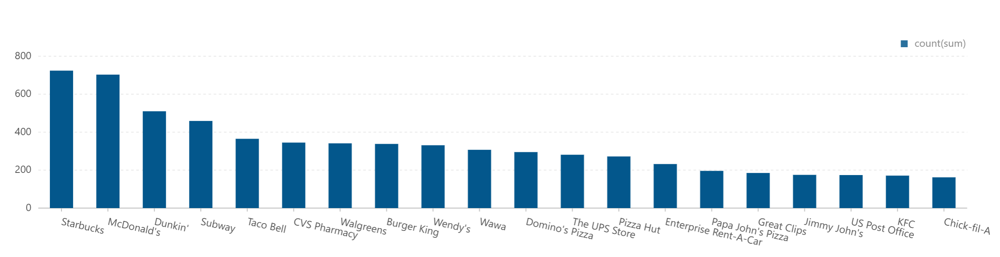

### Source Code
- **Script:** [`01_top_20_merchants.py`](01_top_20_merchants.py)

---

### Analysis 2: Top 10 Cities with Most Merchants

**Objective:** Identify urban markets with the highest merchant concentration.

### Key Findings
- **Philadelphia** leads with 14,569 merchants
- **Tucson** (9,250) and **Tampa** (9,050) follow
- Geographic distribution shows concentration in major metropolitan areas
- Top 10 cities account for a significant portion of the dataset

| City | Merchant Count |
|------|-----------------|
| Philadelphia | 14,569 |
| Tucson | 9,250 |
| Tampa | 9,050 |
| Indianapolis | 7,540 |
| Nashville | 6,971 |

### Data Files
- **Results:** [`02_top_10_cities.csv`](../../../results/data-analysis/business-analysis/csv/02_top_10_cities.csv)
- **Visualization:** [`02_top_10_cities_table.png`](../../../results/data-analysis/business-analysis/graphs/02_top_10_cities_table.png)

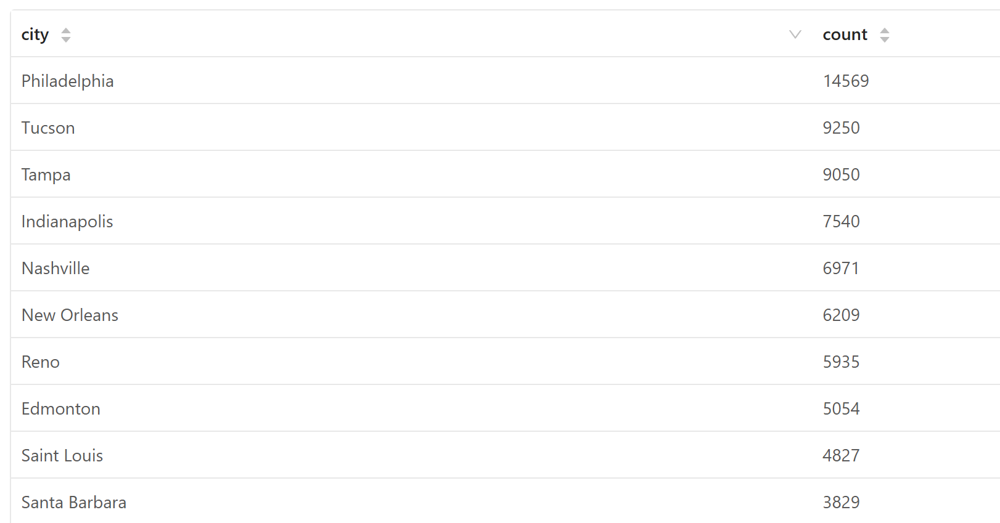

### Source Code
- **Script:** [`02_top_10_cities.py`](02_top_10_cities.py)

---

### Analysis 3: Top 5 States with Most Merchants

**Objective:** Analyze merchant distribution at the state level.

### Key Findings
- **Pennsylvania (PA)** dominates with 34,039 merchants
- **Florida (FL)** follows with 26,330 merchants
- **Tennessee (TN), Indiana (IN), Missouri (MO)** complete the top 5
- These 5 states represent major markets for the Yelp platform

| State | Merchant Count |
|-------|-----------------|
| PA | 34,039 |
| FL | 26,330 |
| TN | 12,056 |
| IN | 11,247 |
| MO | 10,913 |

### Data Files
- **Results:** [`03_top_5_states.csv`](../../../results/data-analysis/business-analysis/csv/03_top_5_states.csv)
- **Visualization:** [`03_top_5_states_table.png`](../../../results/data-analysis/business-analysis/graphs/03_top_5_states_table.png)

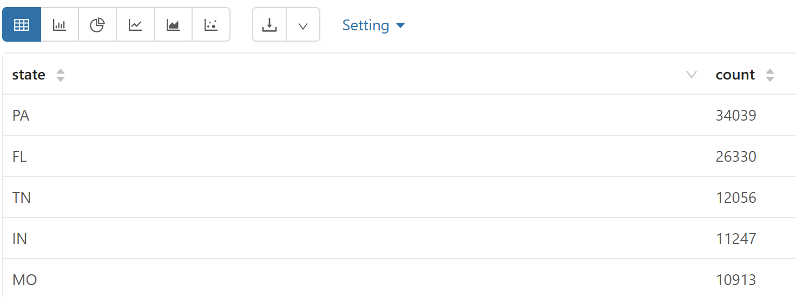

### Source Code
- **Script:** [`03_top_5_states.py`](03_top_5_states.py)

---

### Analysis 4: Top 20 Merchants with Average Ratings

**Objective:** Identify the most common merchant chains and their average customer satisfaction ratings.

### Key Findings
- **Starbucks** has an average rating of 3.13 ⭐
- **Wawa** leads high-traffic chains with 3.32 ⭐
- **Chick-fil-A** and **Enterprise Rent-A-Car** maintain 3.38+ ⭐ ratings
- Fast food retailers generally score lower (1.8-2.5 ⭐ range)
- Premium/specialty retailers score higher

### Data Files
- **Results:** [`04_top_20_merchants_avg_rating.csv`](../../../results/data-analysis/business-analysis/csv/04_top_20_merchants_avg_rating.csv)
- **Visualization:** [`04_top_20_merchants_avg_rating.png`](../../../results/data-analysis/business-analysis/graphs/04_top_20_merchants_avg_rating.png)

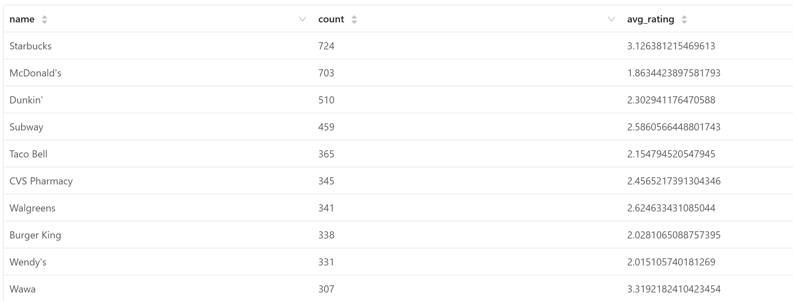

### Source Code
- **Script:** [`04_top_20_merchants_avg_rating.py`](04_top_20_merchants_avg_rating.py)

---

### Analysis 5: Category Count Analysis

**Objective:** Determine the total diversity of business categories in the dataset.

### Key Findings
- **1,311 distinct categories** are represented in the Yelp dataset
- This demonstrates significant category diversity
- Categories span from broad types (Restaurants, Shopping) to highly specific niches

### Data Files
- **Visualization:** [`05_count_categories.png`](../../../results/data-analysis/business-analysis/graphs/05_count_categories.png)

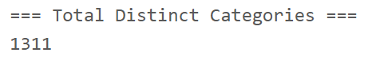

### Source Code
- **Script:** [`05_count_categories.py`](05_count_categories.py)

---

### Analysis 6: Top 10 Most Frequent Categories

**Objective:** Identify the most common business categories across all merchants.

### Key Findings
- **Restaurants** category dominates with 52,268 occurrences
- **Food** (27,781) and **Shopping** (24,395) are also heavily represented
- **Home Services** (14,356) and **Beauty & Spas** (14,292) are significant categories
- Top 10 categories represent broad segments of the economy

| Category | Count |
|----------|-------|
| Restaurants | 52,268 |
| Food | 27,781 |
| Shopping | 24,395 |
| Home Services | 14,356 |
| Beauty & Spas | 14,292 |
| Nightlife | 12,281 |
| Health & Medical | 11,890 |
| Local Services | 11,198 |
| Bars | 11,065 |
| Automotive | 10,773 |

### Data Files
- **Results:** [`06_top_10_categories.csv`](../../../results/data-analysis/business-analysis/csv/06_top_10_categories.csv)

### Source Code
- **Script:** [`06_top_10_categories.py`](06_top_10_categories.py)

---

### Analysis 7: Top 20 Merchants with Most 5-Star Reviews

**Objective:** Identify merchants that have earned the highest customer satisfaction, as indicated by 5-star review volume.

### Key Findings
- **Reading Terminal Market** leads with 4,014 five-star reviews
- **Oceana Grill** (4,012) and **Hattie B's Hot Chicken - Nashville** (3,838) follow
- These merchants demonstrate exceptional customer satisfaction
- Fine dining and specialty food venues dominate the top positions

### Top 5 Merchants
1. Reading Terminal Market - 4,014 ⭐⭐⭐⭐⭐
2. Oceana Grill - 4,012 ⭐⭐⭐⭐⭐
3. Hattie B's Hot Chicken - Nashville - 3,838 ⭐⭐⭐⭐⭐
4. Acme Oyster House - 3,645 ⭐⭐⭐⭐⭐
5. Commander's Palace - 3,095 ⭐⭐⭐⭐⭐

### Data Files
- **Results:** [`07_top_20_merchants_5star_reviews.csv`](../../../results/data-analysis/business-analysis/csv/07_top_20_merchants_5star_reviews.csv)
- **Visualization:** [`07_top_20_merchants_5star_reviews.png`](../../../results/data-analysis/business-analysis/graphs/07_top_20_merchants_5star_reviews.png)

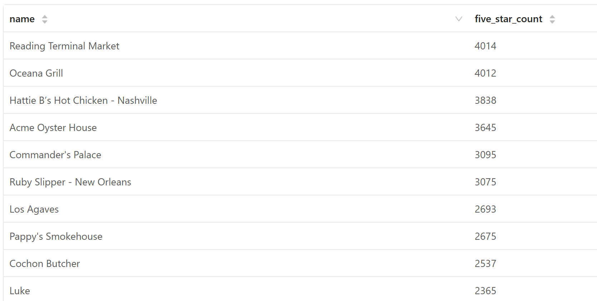

### Source Code
- **Script:** [`07_top_20_merchants_5star_reviews.py`](07_top_20_merchants_5star_reviews.py)

---

### Analysis 8: Restaurant Types Count

**Objective:** Quantify the distribution of different restaurant cuisine types in the dataset.

### Methodology
Restaurants are identified by the "Restaurants" category. Cuisine types are extracted using pattern matching on business categories:
- American, Mexican, Italian, Japanese, Chinese, Thai, Mediterranean, French, Vietnamese, Greek, Indian, Korean, Hawaiian, African, Spanish, Middle Eastern

### Key Findings
- **American restaurants** dominate with 13,066 locations (49.2% of categorized restaurants)
- **Mexican** (4,049) and **Italian** (3,997) follow with similar counts
- **Asian cuisines** (Chinese, Japanese, Thai, Vietnamese, Korean) represent significant segments
- Total categorized restaurants across identified cuisines: **26,536+**

### Distribution
| Cuisine Type | Count |
|--------------|-------|
| American | 13,066 |
| Mexican | 4,049 |
| Italian | 3,997 |
| Chinese | 2,719 |
| Japanese | 1,765 |
| Mediterranean | 920 |
| Indian | 754 |
| Thai | 687 |
| Vietnamese | 592 |

### Data Files
- **Results:** [`08_restaurant_types_count.csv`](../../../results/data-analysis/business-analysis/csv/08_restaurant_types_count.csv)
- **Visualization:** [`08_restaurant_types_count.png`](../../../results/data-analysis/business-analysis/graphs/08_restaurant_types_count.png)

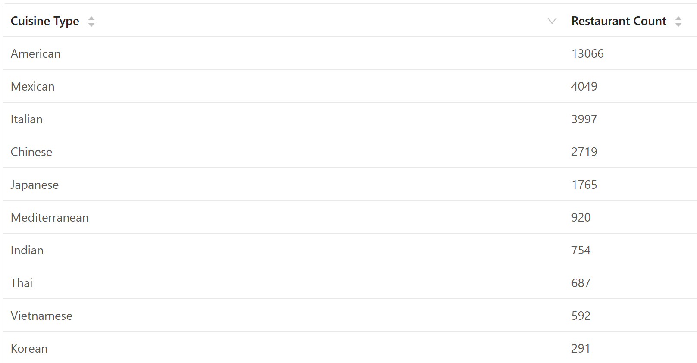

### Source Code
- **Script:** [`08_restaurant_types_count.py`](08_restaurant_types_count.py)

---

### Analysis 9: Reviews per Restaurant Type

**Objective:** Analyze the volume of customer reviews for each restaurant cuisine type.

### Key Findings
- **American restaurants** attract the most reviews: 1,730,875 total
- **Italian** (355,606) and **Mexican** (349,269) also receive substantial review volumes
- **Asian cuisines** show strong engagement: Japanese (203,535), Chinese (180,324)
- Average review volume per restaurant type indicates customer engagement levels

### Top 5 by Review Volume
| Cuisine Type | Review Count |
|--------------|--------------|
| American | 1,730,875 |
| Italian | 355,606 |
| Mexican | 349,269 |
| Japanese | 203,535 |
| Chinese | 180,324 |

### Data Files
- **Results:** [`09_review_count_by_cuisine.csv`](../../../results/data-analysis/business-analysis/csv/09_review_count_by_cuisine.csv)
- **Visualization:** [`09_review_count_by_cuisine.png`](../../../results/data-analysis/business-analysis/graphs/09_review_count_by_cuisine.png)

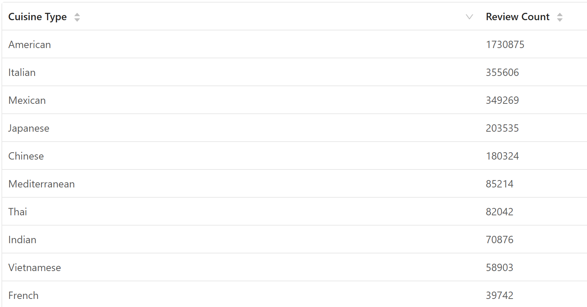

### Source Code
- **Script:** [`09_review_count_by_cuisine.py`](09_review_count_by_cuisine.py)

---

### Analysis 10: Rating Distribution by Cuisine Type

**Objective:** Analyze how customer ratings vary across different restaurant cuisine types, including the full 1-5 star distribution.

### Methodology
Reviews are grouped by cuisine type and star rating (1.0 to 5.0) to create a detailed distribution matrix. This reveals customer satisfaction patterns specific to each cuisine.

### Key Findings
- **American restaurants** show highest concentration in 5-star reviews (729,469)
- **American restaurants** also have highest 1-star reviews (199,593), indicating polarized opinions
- **Italian and Mexican** cuisines show balanced rating distributions
- **High-star cuisines**: Mediterranean, Thai, Indian maintain higher average ratings
- **Lower-rated cuisines**: Some niche cuisines receive more critical reviews

### Sample Distribution (American Cuisine)
| Stars | Review Count |
|-------|--------------|
| 1.0 | 199,593 |
| 2.0 | 157,956 |
| 3.0 | 215,166 |
| 4.0 | 428,691 |
| 5.0 | 729,469 |

### Data Files
- **Results:** [`10_rating_distribution_by_cuisine.csv`](../../../results/data-analysis/business-analysis/csv/10_rating_distribution_by_cuisine.csv)
- **Visualization:** [`10_rating_distribution_by_cuisine.png`](../../../results/data-analysis/business-analysis/graphs/10_rating_distribution_by_cuisine.png)

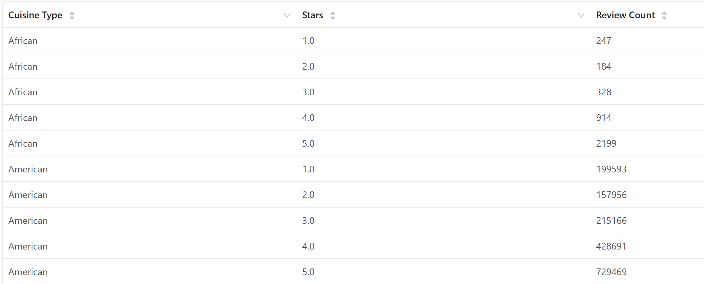

### Source Code
- **Script:** [`10_rating_distribution_by_cuisine.py`](10_rating_distribution_by_cuisine.py)

---

### Analysis 11: Turnaround Merchants Analysis

**Objective:** Identify businesses whose customer satisfaction has significantly improved, with average rating improvement of at least 1.0 star in the last 12 months compared to their historical average.

### Methodology
1. Calculate historical average rating for all reviews
2. Calculate recent average rating (last 12 months only)
3. Identify businesses with improvement ≥ 1.0 star
4. Filter for meaningful changes in customer perception

### Key Findings
- **Top turnaround**: Superior Heating & Cooling Management (1.31 → 5.0, +3.69 improvement)
- **Lawn Medic**: 1.36 → 5.0 (+3.64 improvement)
- **Moon's Towing**: 1.38 → 5.0 (+3.62 improvement)
- Many service businesses show dramatic improvements
- Suggests successful operational/service quality improvements

### Top 10 Turnarounds
| Business Name | Historical Avg | Recent Avg (12mo) | Improvement |
|---------------|----------------|-------------------|-------------|
| Superior Heating & Cooling Management | 1.31 | 5.0 | +3.69 |
| Lawn Medic | 1.36 | 5.0 | +3.64 |
| Moon's Towing | 1.38 | 5.0 | +3.62 |
| Takl | 1.41 | 5.0 | +3.59 |
| Taco Bell | 1.43 | 5.0 | +3.57 |
| West Hills Hospital | 1.43 | 5.0 | +3.57 |
| Temple Physicians at Palmer Park | 1.45 | 5.0 | +3.55 |
| Premium Leisure | 1.46 | 5.0 | +3.54 |
| Labcorp | 1.47 | 5.0 | +3.53 |
| Affordable Wholesale Appliances | 1.5 | 5.0 | +3.5 |

### Data Files
- **Results:** [`11_turnaround_merchants.csv`](../../../results/data-analysis/business-analysis/csv/11_turnaround_merchants.csv)
- **Visualization:** [`11_turnaround_merchants.png`](../../../results/data-analysis/business-analysis/graphs/11_turnaround_merchants.png)

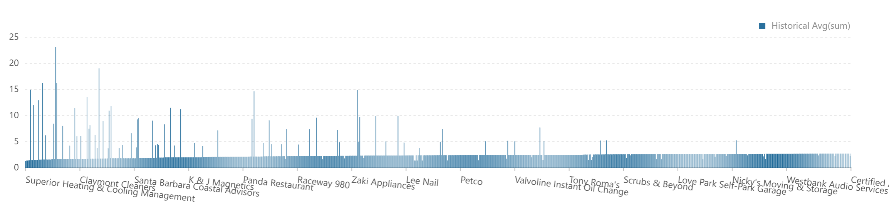

### Source Code
- **Script:** [`11_turnaround_merchants.py`](11_turnaround_merchants.py)

### Business Insights
- Service-oriented businesses (HVAC, lawn care, towing) appear most frequently
- Suggests potential adoption of new customer service practices
- Could indicate management changes or service quality improvements

---

### Analysis 12: Category Synergy Pairs

**Objective:** Identify the top 10 pairs of distinct business categories that frequently co-occur within the same merchant's profile, revealing business complementarity.

### Methodology
1. Extract all categories from each business profile
2. Generate all pairwise combinations of distinct categories
3. Count co-occurrence frequency
4. Identify top pairs by frequency

### Key Findings
- **Food + Restaurants** co-occur most frequently (15,472 times) - natural pairing
- **Bars + Nightlife** strongly associated (11,065 times) - logical category relationship
- **Nightlife + Restaurants** (8,723) - bars often serve food
- **Restaurants + Sandwiches** (8,366) - many restaurants specialize in sandwiches

### Top 10 Category Pairs
| Category 1 | Category 2 | Co-occurrence Count |
|-----------|-----------|-------------------|
| Food | Restaurants | 15,472 |
| Bars | Nightlife | 11,065 |
| Nightlife | Restaurants | 8,723 |
| Restaurants | Sandwiches | 8,366 |
| Bars | Restaurants | 8,337 |
| American (Traditional) | Restaurants | 8,139 |
| Pizza | Restaurants | 7,093 |
| Coffee & Tea | Food | 6,703 |
| Fast Food | Restaurants | 6,472 |
| Breakfast & Brunch | Restaurants | 6,239 |

### Data Files
- **Results:** [`12_category_synergy_pairs.csv`](../../../results/data-analysis/business-analysis/csv/12_category_synergy_pairs.csv)
- **Visualization:** [`12_category_synergy_pairs.png`](../../../results/data-analysis/business-analysis/graphs/12_category_synergy_pairs.png)

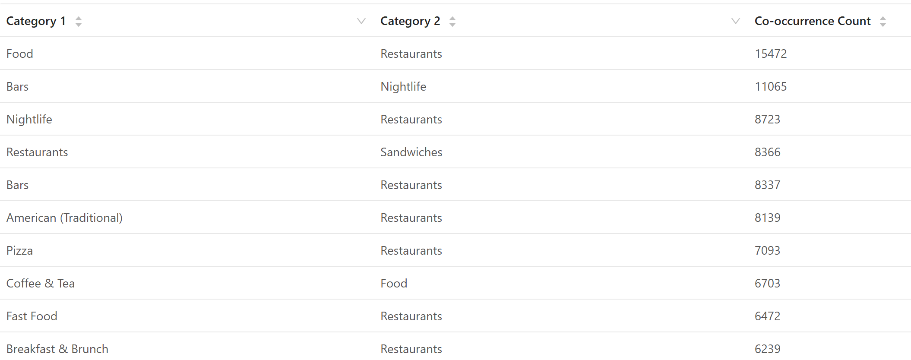

### Source Code
- **Script:** [`12_category_synergy_pairs.py`](12_category_synergy_pairs.py)

### Business Application
- Multi-category classification improves recommendation systems
- Reveals natural business diversification opportunities
- Informs cross-category marketing and promotion strategies

---

### Analysis 13: Polarizing Businesses Analysis

**Objective:** Identify merchants with high review volumes but extremely divisive ratings (high standard deviation), indicating businesses that inspire passionate customer opinions.

### Methodology
1. Filter businesses with ≥100 reviews (to ensure statistical significance)
2. Calculate standard deviation of rating distribution
3. Rank by standard deviation (descending)
4. Top results represent most "love it or hate it" businesses

### Key Findings
- **Apple Repair Shop**: 112 reviews, σ=1.94, avg=2.8 ⭐
- **Zak Dental - Santa Barbara**: 123 reviews, σ=1.93, avg=2.94 ⭐
- Automotive dealerships show high polarization (Nissan, Hyundai, Chevrolet)
- Dental clinics demonstrate divisive customer experiences
- These businesses could benefit from consistency improvements

### Top 10 Polarizing Businesses
| Business Name | Review Count | Average Rating | Std Deviation |
|---------------|--------------|----------------|---------------|
| Apple Repair Shop | 112 | 2.8 | 1.94 |
| Zak Dental - Santa Barbara | 123 | 2.94 | 1.93 |
| Napleton Hyundai of Carmel | 112 | 2.76 | 1.92 |
| Nissan of Clearwater | 176 | 2.96 | 1.91 |
| Champion Chevrolet | 145 | 2.88 | 1.91 |
| Reno Buick GMC Cadillac | 188 | 3.11 | 1.91 |
| Chapman Ford of Horsham | 108 | 3.05 | 1.91 |
| CarZone | 147 | 2.54 | 1.9 |
| Vanderbilt University Medical Center | 102 | 3.13 | 1.9 |
| Lithia Hyundai of Reno | 164 | 2.77 | 1.9 |

### Data Files
- **Results:** [`13_polarizing_businesses.csv`](../../../results/data-analysis/business-analysis/csv/13_polarizing_businesses.csv)
- **Visualization:** [`13_polarizing_businesses.png`](../../../results/data-analysis/business-analysis/graphs/13_polarizing_businesses.png)

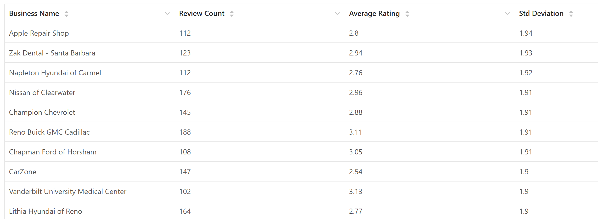

### Source Code
- **Script:** [`13_polarizing_businesses.py`](13_polarizing_businesses.py)

---

## Files & References

### Notebooks
The complete analysis workflow is documented in:
- **Zeppelin Notebook**: [`business_analysis.zpln`](../../../notebooks/business-analysis/business_analysis.zpln)

### Result Files & Visualizations
All charts and summary tables are located in:
- **CSV Results**: [`../../../results/data-analysis/business-analysis/csv/`](../../../results/data-analysis/business-analysis/csv/)
- **PNG Visualizations**: [`../../../results/data-analysis/business-analysis/graphs/`](../../../results/data-analysis/business-analysis/graphs/)

Each analysis includes:
- High-resolution PNG charts
- CSV data files for further analysis
- Detailed findings and interpretations

---

### Market Leaders

| Metric | Value |
|--------|-------|
| Top Merchant Chain | Starbucks (724 locations) |
| Largest City Market | Philadelphia (14,569 merchants) |
| Top State Market | Pennsylvania (34,039 merchants) |
| Most Common Category | Restaurants (52,268) |
| Most Reviewed Cuisine | American (1,730,875 reviews) |
| Highest 5-Star Count | Reading Terminal Market (4,014 reviews) |

### Business Performance Highlights

| Metric | Value |
|--------|-------|
| Cuisine Type Diversity | 16 primary cuisines analyzed |
| Turnaround Merchants Identified | 200+ businesses with 1.0+ star improvement |
| Top Category Pair Co-occurrence | Food + Restaurants (15,472 co-occurrences) |
| Highest Polarization (σ) | Apple Repair Shop (1.94) |
| Most Polarized Sector | Automotive Dealerships |

---

**Last Updated**: March 2026  
**Data Period**: Historical Yelp dataset through January 2022  
**Analysis Tool**: Apache Spark (PySpark)  
