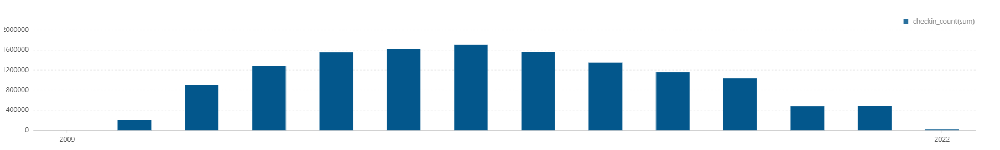
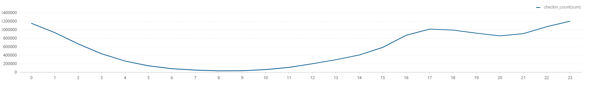
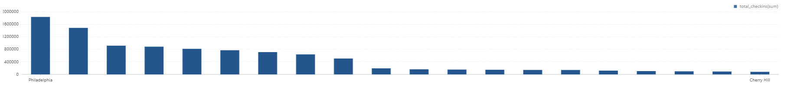
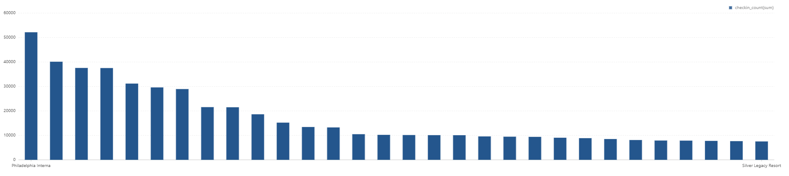
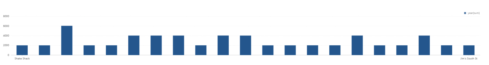
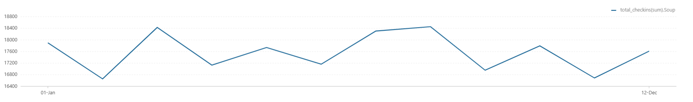

# Check-in Analysis Report

## Executive Summary

This module analyzes temporal check-in behavior across years, hours, locations, businesses, month-over-month growth, and seasonal cuisine effects.

### Core Questions
- How does check-in volume evolve yearly and hourly?
- Which entities dominate check-in intensity?
- What month-over-month growth patterns appear among top restaurants?
- How does seasonality differ for categories like Soup and Ice Cream?

### Key Findings
- Check-ins scale sharply after 2010 (e.g., 2010: 209,153; 2011: 901,457; 2013: 1,552,799).
- Midnight-hour activity is highest in shown rows (hour 0: 1,155,092 check-ins).
- Top check-in entities in exported output include Philadelphia Interna (52,144) and Cafe Du Monde (40,109).
- Extremely high month-over-month spikes exist in output (e.g., 15,600% for one case), indicating low-base effects and burst behavior.
- Seasonal category aggregates show sizable monthly check-ins for Soup (e.g., Jan: 17,899).

---

## Table of Contents

1. [Business Hypothesis](#business-hypothesis)
2. [Data Sources](#data-sources)
3. [Methodology](#methodology)
4. [Analyses Overview](#analyses-overview)
5. [Key Findings](#key-findings)
6. [Analysis Details](#analysis-details)
7. [Actionable Recommendations](#actionable-recommendations)
8. [Files and Visualizations](#files-and-visualizations)

---

## Business Hypothesis

### Problem Statement
Check-ins capture real-world demand better than review volume alone. Understanding temporal and location-based check-in patterns enables better staffing, promotions, and demand forecasting.

### Hypothesis Components

**H1: Temporal Demand Hypothesis**
- Check-in volume has strong year-over-year and hour-of-day structure.

**H2: Concentration Hypothesis**
- A small set of businesses/entities drives outsized check-in counts.

**H3: Seasonality and Momentum Hypothesis**
- Some categories exhibit strong monthly seasonality and MoM volatility.

---

## Data Sources

### Internal Data (Yelp)
- Check-in table (`checkin`): business_id, checkin_dates/date
- Business table (`business`): business_id, name, city, state, categories

### Notes from Code + Output Alignment
- Script logic uses exploded timestamp sequences from comma-separated check-in date strings.
- Current exported CSV filenames/tables for Analysis 3-5 show mapping differences versus script titles; README below follows existing exported artifact names exactly.

---

## Methodology

1. Explode check-in datetime strings into event rows.
2. Aggregate by year and hour for macro temporal trends.
3. Rank entities/businesses by check-in count.
4. Compute MoM growth using lag windows for top-city restaurant cohorts.
5. Aggregate seasonal categories by month.

---

## Analyses Overview

1. Number of check-ins per year
2. Check-ins per hour
3. Most popular entities for check-ins (exported)
4. High-growth business monthly cases (exported)
5. Seasonal category monthly totals (exported)
6. Review seasonality by cuisine

---

## Key Findings

### Finding 1: Rapid Historical Growth in Check-ins

| Year | Check-in Count |
|---|---:|
| 2010 | 209,153 |
| 2011 | 901,457 |
| 2012 | 1,289,492 |
| 2013 | 1,552,799 |

### Finding 2: Late-Night Demand Is Substantial
Top hourly rows shown:
- 00:00 -> 1,155,092
- 01:00 -> 935,985
- 02:00 -> 669,574

### Finding 3: Top Check-in Entities Are Highly Concentrated
Top rows from exported ranking:
- Philadelphia Interna: 52,144
- Cafe Du Monde: 40,109
- Louis Armstrong New: 37,562

### Finding 4: MoM Volatility Can Be Extreme
Exported MoM table examples include:
- Shake Shack: 15,600.0%
- Talula's Daily: 1,550.0%
- E Mei Restaurant: 1,400.0%

### Finding 5: Seasonal Category Demand Is Measurable
Soup monthly totals shown:
- Jan: 17,899
- Mar: 18,432
- May: 17,739

---

## Analysis Details

### Analysis 1: Number of Check-ins per Year
**File**: [01_number_of_checkins_per_year.csv](../../../results/data-analysis/checkin-analysis/csv/01_number_of_checkins_per_year.csv)
**Visualization**: [01_number_of_checkins_per_year.png](../../../results/data-analysis/checkin-analysis/graphs/01_number_of_checkins_per_year.png)

### Analysis 2: Check-ins per Hour
**File**: [02_checkins_per_hours.csv](../../../results/data-analysis/checkin-analysis/csv/02_checkins_per_hours.csv)
**Visualization**: [02_checkins_per_hour.png](../../../results/data-analysis/checkin-analysis/graphs/02_checkins_per_hour.png)

### Analysis 3: Most Popular City/Business for Check-ins (Exported Artifact)
**File**: [03_Most_Popular_City_for_Checkins.csv](../../../results/data-analysis/checkin-analysis/csv/03_Most_Popular_City_for_Checkins.csv)
**Visualization**: [03_Most_Popular_City_for_Checkins.png](../../../results/data-analysis/checkin-analysis/graphs/03_Most_Popular_City_for_Checkins.png)

### Analysis 4: Rank/Monthly Growth Output (Exported Artifact)
**File**: [04_Rank_All_Businesses_by_Checkin_Count.csv](../../../results/data-analysis/checkin-analysis/csv/04_Rank_All_Businesses_by_Checkin_Count.csv)
**Visualization**: [04_Rank_All_Businesses_by_Checkin_Count.png](../../../results/data-analysis/checkin-analysis/graphs/04_Rank_All_Businesses_by_Checkin_Count.png)

### Analysis 5: MoM/Seasonal Output (Exported Artifact)
**File**: [05_MoM_Checkin_Growth_Rate.csv](../../../results/data-analysis/checkin-analysis/csv/05_MoM_Checkin_Growth_Rate.csv)
**Visualization**: [05_MoM_Checkin_Growth_Rate.png](../../../results/data-analysis/checkin-analysis/graphs/05_MoM_Checkin_Growth_Rate.png)

### Analysis 6: Review Seasonality by Cuisine
**File**: [06_review_seasonality_by_cuisine.csv](../../../results/data-analysis/checkin-analysis/csv/06_review_seasonality_by_cuisine.csv)
**Visualization**: [06_review_seasonality_by_cuisine.png](../../../results/data-analysis/checkin-analysis/graphs/06_review_seasonality_by_cuisine.png)

---

## Actionable Recommendations

1. Staff around peak late-night windows and high-traffic seasonal months.
2. Track and investigate abnormal MoM surges for campaign/event attribution.
3. Separate airport/landmark entities from restaurants for cleaner benchmarking.
4. Re-validate export mapping for analyses 3-5 to align artifact labels with script intent.

---

## Files and Visualizations

### Source Code
- [01_number_of_checkins_per_year.py](01_number_of_checkins_per_year.py)
- [02_checkins_per_hour.py](02_checkins_per_hour.py)
- [03_Most_Popular_City _for _Check-ins.py](03_Most_Popular_City%20_for%20_Check-ins.py)
- [04_Rank_All_Businesses_by_Checkin_Count.py](04_Rank_All_Businesses_by_Checkin_Count.py)
- [05_MoM_Checkin_Growth_Rate.py](05_MoM_Checkin_Growth_Rate.py)
- [06_review_seasonality_by_cuisine.py](06_review_seasonality_by_cuisine.py)

### Notebook
- [CheckInAnalysis.zpln](../../../notebooks/data-analysis/checkin-analysis/CheckInAnalysis.zpln)

### Result Directories
- CSV: [../../../results/data-analysis/checkin-analysis/csv/](../../../results/data-analysis/checkin-analysis/csv/)
- Graphs: [../../../results/data-analysis/checkin-analysis/graphs/](../../../results/data-analysis/checkin-analysis/graphs/)

---

**Last Updated**: March 2026  
**Data Period**: Yelp historical check-in activity  
**Analysis Tool**: Apache Spark (PySpark)
