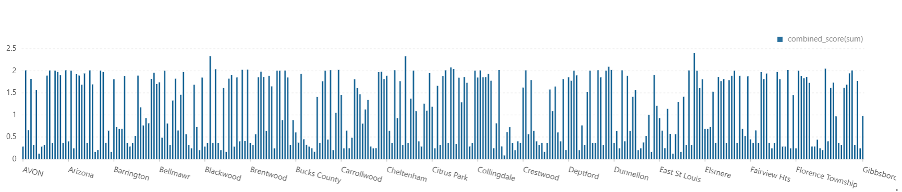
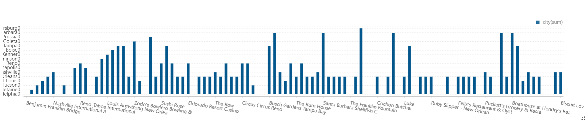
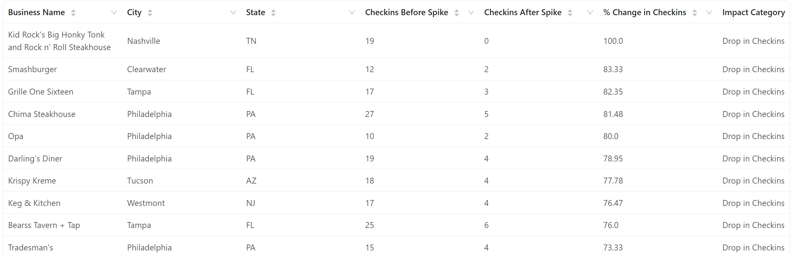
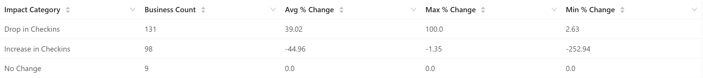
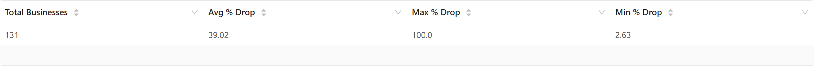
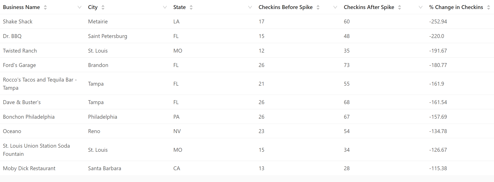
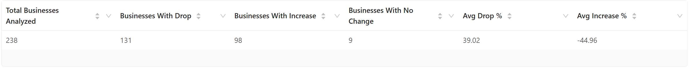

# Comprehensive Analysis Report

Integrated Yelp analysis combining merchant quality, review conversion efficiency, and post-spike check-in dynamics.

## Executive Summary

This module connects **business quality signals** (ratings, reviews, check-ins) into one workflow to answer cross-cutting operational questions:
- Which merchants lead each city when we combine quality and engagement?
- Which high-traffic places convert check-ins into review activity most effectively?
- Which businesses lose or gain engagement after traffic spikes?

### Key Findings
- City-level top performers can be ranked with a blended metric (`combined_score`) using stars, reviews, and check-ins
- Some landmark and transit-heavy businesses show very high review conversion rates (e.g., 48.233 for Benjamin Franklin Bridge)
- In check-in shift analysis (`03_checkin_dropoff_analysis_1.csv`), 238 businesses were analyzed: 131 drops, 98 increases, 9 unchanged
- Average drop magnitude among drop cases is 39.02%, while the increase group averages -44.96% in the script's signed `% Change` convention

---

## Table of Contents

1. [Business Hypothesis](#business-hypothesis)
2. [Data Sources](#data-sources)
3. [Methodology](#methodology)
4. [Analyses Overview](#analyses-overview)
5. [Analysis Details](#analysis-details)
6. [Files and References](#files-and-references)

---

## Business Hypothesis

### Problem Statement
Teams need one joined view of business attractiveness, customer action, and engagement durability:
1. **City Positioning** - Which merchants are strongest within each local market?
2. **Engagement Conversion** - Which businesses convert visits/check-ins into reviews better?
3. **Stability Monitoring** - Which merchants are vulnerable to post-peak decline?

### Hypotheses to Test
- **H1: Blended leaders hypothesis** - Top city merchants emerge clearly when ratings and engagement are combined
- **H2: Conversion efficiency hypothesis** - High-footfall businesses vary significantly in turning check-ins into reviews
- **H3: Dropoff asymmetry hypothesis** - Post-spike engagement drops affect more businesses than sustained increases

---

## Data Sources

- Yelp business metadata (name, city/state, stars, categories)
- Yelp review aggregates (review counts)
- Yelp check-in aggregates (check-in counts)
- Derived output tables in `results/data-analysis/comprehensive-analysis/csv/`

---

## Methodology

### Analysis Framework

1. **City Leaderboard Construction**
   - Rank top 5 merchants per city with a normalized `combined_score`
2. **Review Conversion Profiling**
   - Compute `conversion_rate = total_checkins / total_reviews`
   - Focus on high-volume candidates
3. **Check-in Dropoff Detection**
   - Compare before-spike vs. after-spike check-ins
   - Segment businesses into drop/increase/no-change groups
   - Produce summary and detailed drill-down tables

### Key Metrics

| Metric | Definition |
|--------|-----------|
| Combined Score | Composite ranking score from stars, reviews, and check-ins |
| Conversion Rate | `total_checkins / total_reviews` |
| % Change in Checkins | Relative shift before vs. after spike |
| Impact Category | `Drop in Checkins`, `Increase in Checkins`, `No Change` |

---

## Analyses Overview

- **Analysis 1**: Top 5 merchants per city (`01_top5_merchants_per_city.py`)
- **Analysis 2**: Review conversion rate benchmarking (`02_review_conversion_rate.py`)
- **Analysis 3**: Check-in dropoff analysis with 5 result tables (`03_checkin_dropoff_analysis.py`)

---

## Analysis Details

### Analysis 1: Top 5 Merchants per City

**Objective:** Identify city-level business leaders using a blended quality-engagement score.

**Output highlights:**
- Columns include `city`, `rank`, `name`, `stars`, `review_count`, `checkin_count`, `combined_score`
- Supports within-city benchmarking and local competitor tracking

**Files:**
- **Results:** [`01_top5_merchants_per_city.csv`](../../../results/data-analysis/comprehensive-analysis/csv/01_top5_merchants_per_city.csv)
- **Visualization:** [`01_top5_merchants_per_city.png`](../../../results/data-analysis/comprehensive-analysis/graph/01_top5_merchants_per_city.png)
- **Script:** [`01_top5_merchants_per_city.py`](01_top5_merchants_per_city.py)

| city | rank | name | stars | review_count | checkin_count |
|------|------|------|-------|--------------|---------------|
| AVON | 1 | Jack's Donuts - Avon | 3.5 | 24 | 37 |
| Abington | 1 | 2 Fat Dogs | 5.0 | 85 | 26 |

---

### Analysis 2: Review Conversion Rate

**Objective:** Measure how efficiently businesses convert check-in activity into customer review output.

**Output highlights:**
- Includes business/location metadata, stars, total check-ins, total reviews, and `conversion_rate`
- Example top row: Benjamin Franklin Bridge at `48.233`

**Files:**
- **Results:** [`02_review_conversion_rate.csv`](../../../results/data-analysis/comprehensive-analysis/csv/02_review_conversion_rate.csv)
- **Visualization:** [`02_review_conversion_rate.png`](../../../results/data-analysis/comprehensive-analysis/graph/02_review_conversion_rate.png)
- **Script:** [`02_review_conversion_rate.py`](02_review_conversion_rate.py)

| business_name | city | state | stars | total_checkins | total_reviews | conversion_rate |
|---------------|------|-------|-------|----------------|---------------|-----------------|
| Benjamin Franklin Bridge | Philadelphia | PA | 4.5 | 4968 | 103 | 48.233 |
| Lakeside Shopping Center | Metairie | LA | 3.5 | 4302 | 100 | 43.020 |

---

### Analysis 3: Check-in Dropoff Analysis

**Objective:** Detect and characterize post-spike check-in decline or growth patterns.

**Output highlights:**
- Summary table (`_1`) with counts and averages
- Extreme movement table (`_2`) showing largest signed percentage shifts
- Drop-only summary (`_3`)
- Category-level impact statistics (`_4`)
- Full classified business table (`_5`)

**Files:**
- **Results:**
  - [`03_checkin_dropoff_analysis_1.csv`](../../../results/data-analysis/comprehensive-analysis/csv/03_checkin_dropoff_analysis_1.csv)
  - [`03_checkin_dropoff_analysis_2.csv`](../../../results/data-analysis/comprehensive-analysis/csv/03_checkin_dropoff_analysis_2.csv)
  - [`03_checkin_dropoff_analysis_3.csv`](../../../results/data-analysis/comprehensive-analysis/csv/03_checkin_dropoff_analysis_3.csv)
  - [`03_checkin_dropoff_analysis_4.csv`](../../../results/data-analysis/comprehensive-analysis/csv/03_checkin_dropoff_analysis_4.csv)
  - [`03_checkin_dropoff_analysis_5.csv`](../../../results/data-analysis/comprehensive-analysis/csv/03_checkin_dropoff_analysis_5.csv)
- **Visualizations:**
  - [`03_checkin_dropoff_analysis_1.png`](../../../results/data-analysis/comprehensive-analysis/graph/03_checkin_dropoff_analysis_1.png)
  - [`03_checkin_dropoff_analysis_2.png`](../../../results/data-analysis/comprehensive-analysis/graph/03_checkin_dropoff_analysis_2.png)
  - [`03_checkin_dropoff_analysis_3.png`](../../../results/data-analysis/comprehensive-analysis/graph/03_checkin_dropoff_analysis_3.png)
  - [`03_checkin_dropoff_analysis_4.png`](../../../results/data-analysis/comprehensive-analysis/graph/03_checkin_dropoff_analysis_4.png)
  - [`03_checkin_dropoff_analysis_5.png`](../../../results/data-analysis/comprehensive-analysis/graph/03_checkin_dropoff_analysis_5.png)
- **Script:** [`03_checkin_dropoff_analysis.py`](03_checkin_dropoff_analysis.py)

**CSV preview: `03_checkin_dropoff_analysis_1.csv`**

| Total Businesses Analyzed | Businesses With Drop | Businesses With Increase | Businesses With No Change | Avg Drop % | Avg Increase % |
|---------------------------|----------------------|--------------------------|---------------------------|------------|----------------|
| 238 | 131 | 98 | 9 | 39.02 | -44.96 |

**CSV preview: `03_checkin_dropoff_analysis_2.csv`**

| Business Name | City | State | Checkins Before Spike | Checkins After Spike | % Change in Checkins |
|---------------|------|-------|-----------------------|----------------------|----------------------|
| Shake Shack | Metairie | LA | 17 | 60 | -252.94 |
| Dr. BBQ | Saint Petersburg | FL | 15 | 48 | -220.00 |

**CSV preview: `03_checkin_dropoff_analysis_3.csv`**

| Total Businesses | Avg % Drop | Max % Drop | Min % Drop |
|------------------|------------|------------|------------|
| 131 | 39.02 | 100.0 | 2.63 |

**CSV preview: `03_checkin_dropoff_analysis_4.csv`**

| Impact Category | Business Count | Avg % Change | Max % Change | Min % Change |
|-----------------|----------------|--------------|--------------|--------------|
| Drop in Checkins | 131 | 39.02 | 100.0 | 2.63 |
| Increase in Checkins | 98 | -44.96 | -1.35 | -252.94 |

**CSV preview: `03_checkin_dropoff_analysis_5.csv`**

| Business Name | City | State | Checkins Before Spike | Checkins After Spike | % Change in Checkins | Impact Category |
|---------------|------|-------|-----------------------|----------------------|----------------------|-----------------|
| Kid Rock's Big Honky Tonk and Rock n' Roll Steakhouse | Nashville | TN | 19 | 0 | 100.0 | Drop in Checkins |
| Smashburger | Clearwater | FL | 12 | 2 | 83.33 | Drop in Checkins |

---

## Files and References

### Notebook
- [`01-02_comprehensive_analysis.zpln`](../../../notebooks/data-analysis/comprehensive-analysis/01-02_comprehensive_analysis.zpln)
- [`03_checkin_dropoff_analysis.zpln`](../../../notebooks/data-analysis/comprehensive-analysis/03_checkin_dropoff_analysis.zpln)

### Output folders
- **CSV:** [`../../../results/data-analysis/comprehensive-analysis/csv/`](../../../results/data-analysis/comprehensive-analysis/csv/)
- **Graphs:** [`../../../results/data-analysis/comprehensive-analysis/graph/`](../../../results/data-analysis/comprehensive-analysis/graph/)

---

**Last Updated**: March 2026  
**Tooling**: Apache Spark (PySpark)

