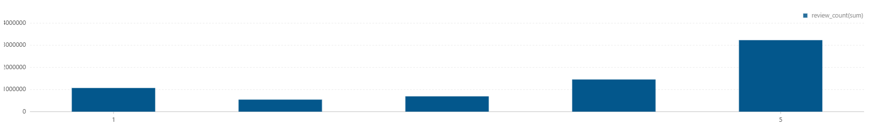
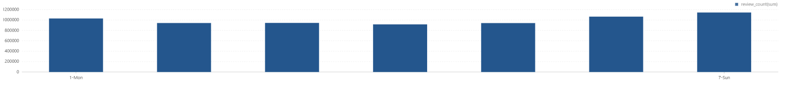
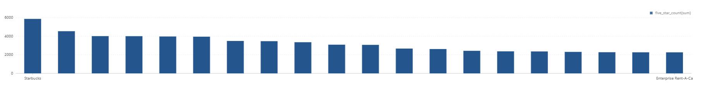
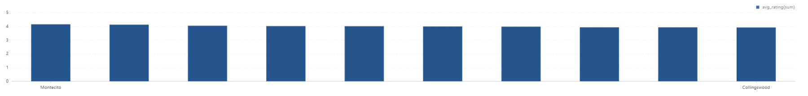
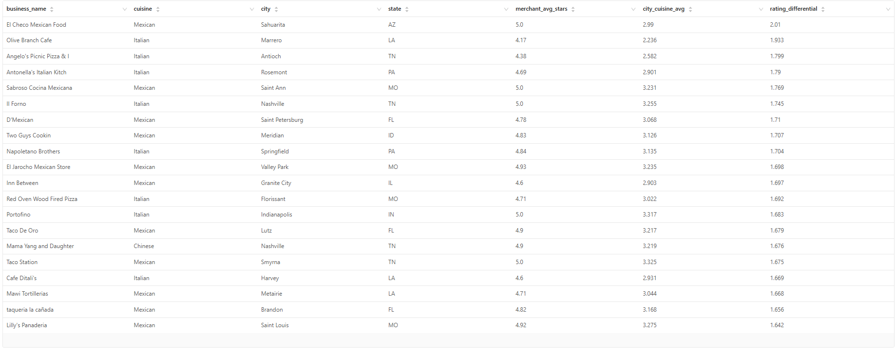
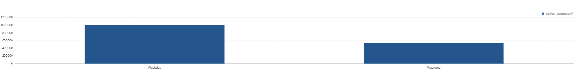
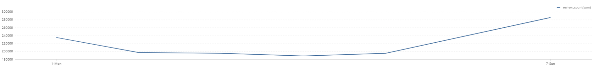

# Rating Analysis Report

## Executive Summary

This module analyzes rating distribution patterns, weekly sentiment cycles, city-level quality, cuisine-city differential performance, and nightlife weekday/weekend behavior.

### Core Questions
- How are ratings distributed from 1 to 5 stars?
- Do review volume and average rating vary by weekday?
- Which businesses and cities overperform on rating signals?
- How much does a merchant outperform its city-cuisine baseline?
- Does nightlife sentiment differ on weekends vs weekdays?

### Key Findings
- Rating mix is strongly positive: 5-star reviews are 46.23% (3,231,627), while 1-star reviews are 15.30% (1,069,561).
- Midweek ratings are slightly stronger than Monday (e.g., Wed avg 3.770 vs Mon 3.720 in the shown rows).
- Top five-star count leaders include Starbucks (5,877) and First Watch (4,550).
- Highest-rated eligible city in output is Montecito (4.156 average across 93 merchants).
- Strong cuisine-city outperformance exists: top differential reaches +2.01 stars.
- Nightlife ratings are lower on weekends (3.728) than weekdays (3.825).

---

## Table of Contents

1. [Business Hypothesis](#business-hypothesis)
2. [Data Sources](#data-sources)
3. [Methodology](#methodology)
4. [Analyses Overview](#analyses-overview)
5. [Key Findings](#key-findings)
6. [Analysis Details](#analysis-details)
7. [Actionable Recommendations](#actionable-recommendations)
8. [Files and Visualizations](#files-and-visualizations)

---

## Business Hypothesis

### Problem Statement
Rating behavior encodes customer satisfaction, local quality variance, and day-part/weekday effects. Identifying these structures enables more accurate benchmarking and operational prioritization.

### Hypothesis Components

**H1: Distribution Hypothesis**
- Yelp ratings are positively skewed, but low-star tails remain operationally significant.

**H2: Temporal Hypothesis**
- Day-of-week patterns affect both review volume and average rating.

**H3: Relative-Performance Hypothesis**
- Merchant quality should be evaluated relative to city+cuisine baseline, not absolute stars alone.

**H4: Category Context Hypothesis**
- Nightlife shows distinct weekday/weekend satisfaction behavior.

---

## Data Sources

### Internal Data (Yelp)
- Review table (`review`): rev_stars, rev_date, rev_business_id, review_id
- Business table (`business`): business_id, name, city, state, categories, stars

### Scope
- Global star distribution
- Weekly/day-level trends
- Business/city/cuisine differential performance
- Nightlife temporal split

---

## Methodology

1. Distribution: aggregate counts by `rev_stars` and compute percentages.
2. Weekly trend: map Spark `dayofweek` to ordered day labels and compute count + average stars.
3. Top businesses: count 5-star reviews per merchant.
4. City quality: average business stars by city with merchant-count threshold (`>= 50`).
5. Differential model: explode cuisines and compute merchant average minus city-cuisine window average.
6. Nightlife comparison: split reviews into `Weekend` vs `Weekday` and compute count + average.

---

## Analyses Overview

1. Rating distribution
2. Weekly rating frequency
3. Top businesses by five-star count
4. Top 10 cities with highest ratings
5. Rating differential by cuisine and city
6A. Nightlife weekend vs weekday summary
6B. Nightlife daily breakdown

---

## Key Findings

### Finding 1: Ratings Are Strongly Top-Heavy

| Stars | Review Count | Percentage |
|---|---:|---:|
| 1 | 1,069,561 | 15.30% |
| 2 | 544,240 | 7.79% |
| 3 | 691,934 | 9.90% |
| 4 | 1,452,918 | 20.78% |
| 5 | 3,231,627 | 46.23% |

### Finding 2: Weekday Signal Is Not Uniform
- Monday avg rating: 3.720 (1,030,129 reviews)
- Wednesday avg rating: 3.770 (945,565 reviews)
- Thursday avg rating: 3.778 (917,648 reviews)

### Finding 3: Five-Star Volume Leaders Are Concentrated
Top output rows:
- Starbucks: 5,877
- First Watch: 4,550
- Reading Terminal Mar: 4,019
- Oceana Grill: 4,012
- Acme Oyster House: 3,979

### Finding 4: City-Level Quality Leaders Are Clear
Top output rows:
- Montecito: 4.156 (93 merchants)
- Safety Harbor: 4.129 (139 merchants)
- Santa Barbara: 4.051 (3,829 merchants)

### Finding 5: Merchant Outperformance vs Local Baseline Is Material
Top output differential:
- El Checo Mexican Food (Sahuarita, AZ): +2.01

### Finding 6: Nightlife Performs Better on Weekdays Than Weekends
- Weekday: 1,012,962 reviews, avg 3.825
- Weekend: 526,795 reviews, avg 3.728

---

## Analysis Details

### Analysis 1: Rating Distribution
**File**: [01_rating_distribution.csv](../../../results/data-analysis/rating-analysis/csv/01_rating_distribution.csv)
**Visualization**: [01_rating_distribution_chart.png](../../../results/data-analysis/rating-analysis/graphs/01_rating_distribution_chart.png)

### Analysis 2: Weekly Rating Frequency
**File**: [02_weekly_rating_frequency.csv](../../../results/data-analysis/rating-analysis/csv/02_weekly_rating_frequency.csv)
**Visualization**: [02_weekly_rating_frequency_chart.png](../../../results/data-analysis/rating-analysis/graphs/02_weekly_rating_frequency_chart.png)

### Analysis 3: Top Businesses with Most Five Stars
**File**: [03_top_businesses_with_most_five_stars.csv](../../../results/data-analysis/rating-analysis/csv/03_top_businesses_with_most_five_stars.csv)
**Visualization**: [03_top_businesses_with_most_five_star_chart.png](../../../results/data-analysis/rating-analysis/graphs/03_top_businesses_with_most_five_star_chart.png)

### Analysis 4: Top Ten Cities with Highest Ratings
**File**: [04_top_ten_cities_with_highest_ratings.csv](../../../results/data-analysis/rating-analysis/csv/04_top_ten_cities_with_highest_ratings.csv)
**Visualization**: [04_top_ten_cities_with_highest_ratings.png](../../../results/data-analysis/rating-analysis/graphs/04_top_ten_cities_with_highest_ratings.png)

### Analysis 5: Rating Differential by Cuisine and City
**File**: [05_rating_differential_by_cuisine_and_city.csv](../../../results/data-analysis/rating-analysis/csv/05_rating_differential_by_cuisine_and_city.csv)
**Visualization**: [05_rating_differential_by_cuisine_and_city_table.png](../../../results/data-analysis/rating-analysis/graphs/05_rating_differential_by_cuisine_and_city_table.png)

### Analysis 6A: Weekend vs Weekdays for Nightlife (Summary)
**File**: [06A_weekend_vs_weekdays_for_nightlife.csv](../../../results/data-analysis/rating-analysis/csv/06A_weekend_vs_weekdays_for_nightlife.csv)
**Visualization**: [06A_weekend_vs_weekdays_for_nightlife_summary_chart.png](../../../results/data-analysis/rating-analysis/graphs/06A_weekend_vs_weekdays_for_nightlife_summary_chart.png)

### Analysis 6B: Weekend vs Weekdays Daily Breakdown
**File**: [06B_weekend_vs_weekdays_daily_breakdown.csv](../../../results/data-analysis/rating-analysis/csv/06B_weekend_vs_weekdays_daily_breakdown.csv)
**Visualization**: [06B_weekend_vs_weekdays_daily_breakdown.png](../../../results/data-analysis/rating-analysis/graphs/06B_weekend_vs_weekdays_daily_breakdown.png)

---

## Actionable Recommendations

1. Track 1-star rate as an independent risk KPI despite overall positive skew.
2. Run weekday-specific staffing/quality experiments for Monday underperformance.
3. Use city-cuisine differential ranking for targeted merchant coaching.
4. For nightlife, prioritize weekend service stabilization to reduce rating drag.

---

## Files and Visualizations

### Source Code
- [01_rating_distribution.py](01_rating_distribution.py)
- [02_weekly_rating_frequency.py](02_weekly_rating_frequency.py)
- [03_top_businesses_with_most_five_stars.py](03_top_businesses_with_most_five_stars.py)
- [04_top_ten_cities_with_highest_ratings.py](04_top_ten_cities_with_highest_ratings.py)
- [05_rating_differential_by_cuisine_and_city.py](05_rating_differential_by_cuisine_and_city.py)
- [06_weekend_vs_weekdays_for_nightlife.py](06_weekend_vs_weekdays_for_nightlife.py)

### Notebook
- [RatingAnalysis.zpln](../../../notebooks/data-analysis/rating-analysis/RatingAnalysis.zpln)

### Result Directories
- CSV: [../../../results/data-analysis/rating-analysis/csv/](../../../results/data-analysis/rating-analysis/csv/)
- Graphs: [../../../results/data-analysis/rating-analysis/graphs/](../../../results/data-analysis/rating-analysis/graphs/)

---

**Last Updated**: March 2026  
**Data Period**: Yelp historical review and business ratings  
**Analysis Tool**: Apache Spark (PySpark)
