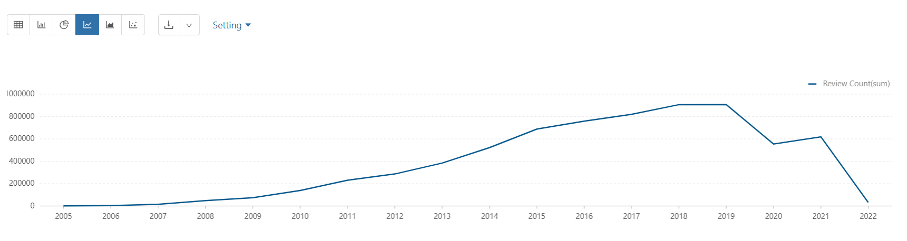
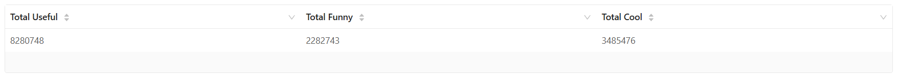
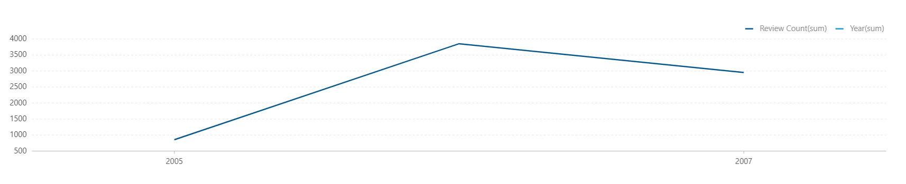
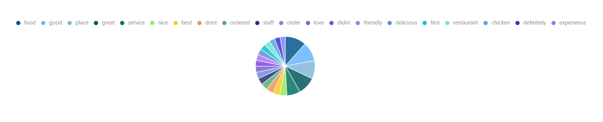
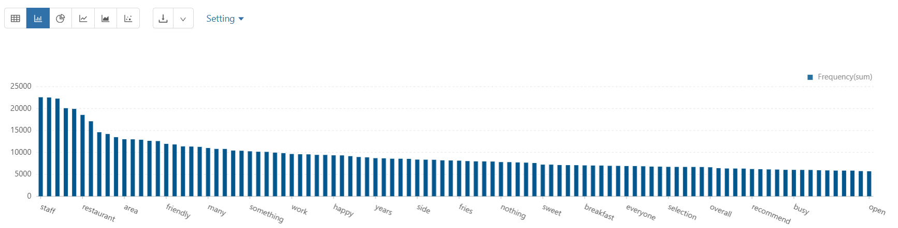
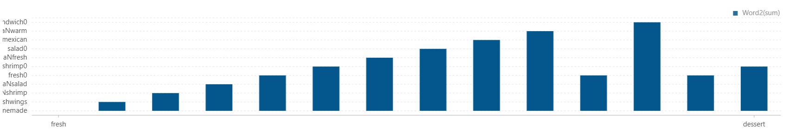
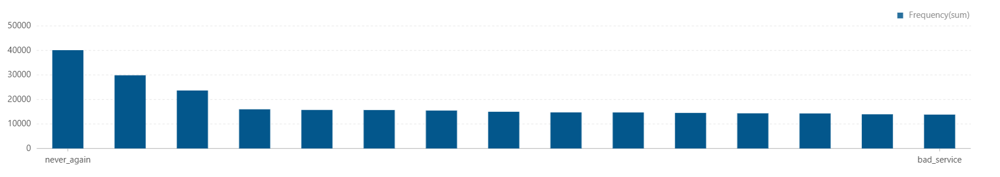
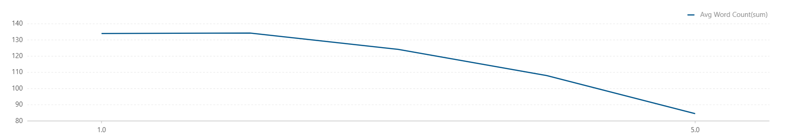
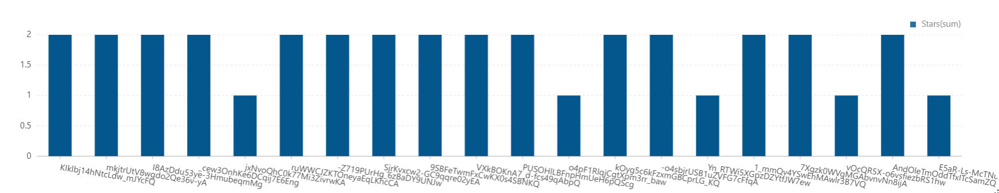
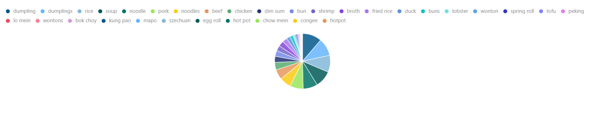

# Review Analysis Report

## Executive Summary

This module analyzes review volume, engagement signals, sentiment language, pain-point patterns, text length behavior, mixed-signal reviews, and menu-item extraction from Chinese restaurant reviews.

### Core Questions
- How does review volume evolve over time?
- What is the platform-wide engagement signal from useful/funny/cool votes?
- Which words and bigrams dominate positive and negative narratives?
- What pain points are most recurrent in low-star reviews?
- How does review length vary by star rating?
- Which menu items are most discussed for top Chinese restaurants?

### Key Findings
- Review volume grows rapidly in early years shown (2005: 854 to 2009: 74,387).
- Social reaction totals are large: useful 8,280,748; funny 2,282,743; cool 3,485,476.
- Most common words include food (3,595,656), good (3,277,585), place (3,153,865).
- Positive bigrams center around service and quality (`food great`, `great service`).
- Negative bigrams emphasize severe dissatisfaction (`waste money`, `terrible service`).
- Pain-point bigrams show high recurrence (`never_again`, `waited_minutes`, `waste_money`).
- Review length inversely correlates with stars in output: 1-star reviews average 134.0 words vs 5-star at 84.5.

---

## Table of Contents

1. [Business Hypothesis](#business-hypothesis)
2. [Data Sources](#data-sources)
3. [Methodology](#methodology)
4. [Analyses Overview](#analyses-overview)
5. [Key Findings](#key-findings)
6. [Analysis Details](#analysis-details)
7. [Actionable Recommendations](#actionable-recommendations)
8. [Files and Visualizations](#files-and-visualizations)

---

## Business Hypothesis

### Problem Statement
Review text contains structured signals for quality, friction, sentiment ambiguity, and product-level demand. Extracting these patterns improves quality diagnostics and menu/category strategy.

### Hypothesis Components

**H1: Language Signal Hypothesis**
- Lexical and bigram patterns separate positive and negative experience profiles.

**H2: Pain-Point Hypothesis**
- Low-star reviews repeatedly mention a compact set of operational pain themes.

**H3: Ambiguity Hypothesis**
- Mixed-signal reviews (low stars + positive words) identify expectation gaps or partial recovery cases.

**H4: Product Signal Hypothesis**
- Menu item mentions in review text reveal high-demand dishes by cuisine segment.

---

## Data Sources

### Internal Data (Yelp)
- Review table (`yelp.review`): rev_id, rev_user_id, rev_business_id, rev_date, rev_stars, rev_text, rev_useful, rev_funny, rev_cool
- Business table (`yelp.json_business` / parsed JSON): business_id, name, city, categories, review_count, stars

### Scope
- Temporal review trends
- NLP token/bigram extraction with curated stopword/seed logic
- POS-tagged word cloud and association graphs
- Mixed-signal and cuisine-specific menu mention extraction

---

## Methodology

1. Aggregate annual review counts and reaction totals.
2. Generate top words after lowercasing, cleanup, stopword filtering.
3. Extract positive and negative bigrams with POS/seed constraints.
4. Build pain-point bigrams from <=2 star reviews using pain-word dictionary.
5. Compute average review length by star rating.
6. Identify mixed-signal reviews with low stars but multiple positive lexicon hits.
7. For Chinese restaurants, identify top businesses then extract predefined menu keywords from review text.

---

## Analyses Overview

1. Reviews per year
2. Useful/Funny/Cool totals
3. Total number of reviews per user per year
4. Top 20 common words
5. Top 10 positive-review bigrams
6. Top 10 negative-review bigrams
7. POS-tagging word cloud
8. Word association graph
9. Top 15 pain-point bigrams
10. Review length vs rating
11. Mixed-signal reviews
12. Menu items in Chinese restaurant reviews

---

## Key Findings

### Finding 1: Reviews and Engagement Are Massive
- Reviews per year (sample rows): 2005 -> 854, 2006 -> 3,853, 2007 -> 15,363, 2008 -> 48,226, 2009 -> 74,387
- Useful/Funny/Cool totals:
  - Useful: 8,280,748
  - Funny: 2,282,743
  - Cool: 3,485,476

### Finding 2: Core Lexicon Is Dominated by Food and Service Vocabulary
Top words:
- food (3,595,656)
- good (3,277,585)
- place (3,153,865)
- great (3,055,940)
- service (2,296,961)

### Finding 3: Positive and Negative Narrative Phrases Are Distinct
Positive top bigrams:
- food great (5,760)
- great service (5,357)

Negative top bigrams:
- waste money (1,000)
- terrible service (789)
- poor service (764)

### Finding 4: Pain-Point Signals Are Highly Repetitive
Top rows from pain-point output:
- never_again (40,116)
- waited_minutes (29,860)
- waste_money (23,655)

### Finding 5: Lower Ratings Correlate with Longer Reviews
- 1.0 stars -> 134.0 average words
- 5.0 stars -> 84.5 average words

### Finding 6: Mixed-Signal Low-Star Reviews Exist
- Output includes low-star reviews with high positive keyword counts, supporting expectation-gap or inconsistency patterns.

---

## Analysis Details

### Analysis 1: Reviews per Year
**File**: [01_reviews_per_year.csv](../../../results/data-analysis/review-analysis/csv/01_reviews_per_year.csv)
**Visualization**: [01_reviews_per_year.png](../../../results/data-analysis/review-analysis/graph/01_reviews_per_year.png)

### Analysis 2: Useful Funny Cool Reviews
**File**: [02_useful__funny_cool_reviews.csv](../../../results/data-analysis/review-analysis/csv/02_useful__funny_cool_reviews.csv)
**Visualization**: [02_useful_funny_cool_reviews.png](../../../results/data-analysis/review-analysis/graph/02_useful_funny_cool_reviews.png)

### Analysis 3: Total Number of Reviews
**File**: [03_total_number_of_reviews.csv](../../../results/data-analysis/review-analysis/csv/03_total_number_of_reviews.csv)
**Visualization**: [03_total_number_of_reviews_per_user_per_year.png](../../../results/data-analysis/review-analysis/graph/03_total_number_of_reviews_per_user_per_year.png)

### Analysis 4: Top 20 Common Words
**File**: [04_top_20_common_words.csv](../../../results/data-analysis/review-analysis/csv/04_top_20_common_words.csv)
**Visualization**: [04_top_20_common_words.png](../../../results/data-analysis/review-analysis/graph/04_top_20_common_words.png)

### Analysis 5: Top 10 Bigrams Positive Reviews
**File**: [05_top_10_bigrams_positive_reviews.csv](../../../results/data-analysis/review-analysis/csv/05_top_10_bigrams_positive_reviews.csv)
**Visualization**: [05_top_10_bigrams_positive_reviews.png](../../../results/data-analysis/review-analysis/graph/05_top_10_bigrams_positive_reviews.png)

### Analysis 6: Top 10 Bigrams Negative Reviews
**File**: [06_top_10_bigrams_negative_reviews.csv](../../../results/data-analysis/review-analysis/csv/06_top_10_bigrams_negative_reviews.csv)
**Visualization**: [06_top_10_bigrams_negative_reviews.png](../../../results/data-analysis/review-analysis/graph/06_top_10_bigrams_negative_reviews.png)

### Analysis 7: Word Cloud POS Tagging
**File**: [07_word_cloud_pos_tagging.csv](../../../results/data-analysis/review-analysis/csv/07_word_cloud_pos_tagging.csv)
**Visualization**: [07_word_cloud_pos_tagging.png](../../../results/data-analysis/review-analysis/graph/07_word_cloud_pos_tagging.png)

### Analysis 8: Word Association Graph
**File**: [08_word_association_graph.csv](../../../results/data-analysis/review-analysis/csv/08_word_association_graph.csv)
**Visualization**: [08_word_association_graph.png](../../../results/data-analysis/review-analysis/graph/08_word_association_graph.png)

### Analysis 9: Top 15 Pain Point Bigrams
**File**: [09_top_15_pain_point_bigrams.csv](../../../results/data-analysis/review-analysis/csv/09_top_15_pain_point_bigrams.csv)
**Visualization**: [09_top_15_pain_point_bigrams.png](../../../results/data-analysis/review-analysis/graph/09_top_15_pain_point_bigrams.png)

### Analysis 10: Review Length vs Rating
**File**: [10_review_length_vs_rating.csv](../../../results/data-analysis/review-analysis/csv/10_review_length_vs_rating.csv)
**Visualization**: [10_review_length_vs_rating.png](../../../results/data-analysis/review-analysis/graph/10_review_length_vs_rating.png)

### Analysis 11: Mixed Signal Reviews
**File**: [11_mixed_signal_reviews.csv](../../../results/data-analysis/review-analysis/csv/11_mixed_signal_reviews.csv)
**Visualization**: [11_mixed_signal_reviews.png](../../../results/data-analysis/review-analysis/graph/11_mixed_signal_reviews.png)

### Analysis 12: Menu Items Chinese Restaurants
**File**: [12_menu_items_chinese_restaurants.csv](../../../results/data-analysis/review-analysis/csv/12_menu_items_chinese_restaurants.csv)
**Visualization**: [12_menu_items_chinese_restaurants.png](../../../results/data-analysis/review-analysis/graph/12_menu_items_chinese_restaurants.png)

---

## Actionable Recommendations

1. Add pain-point bigrams to monitoring dashboards for operational alerting.
2. Use mixed-signal detection to route nuanced recovery workflows.
3. Treat review length as an additional dissatisfaction indicator.
4. Use cuisine-specific menu mention trends for merchandising and promotions.
5. Evolve from unigram/bigram rules to embedding-based semantic clustering for robust topic mining.

---

## Files and Visualizations

### Source Code
- [01_reviews_per_year.py](01_reviews_per_year.py)
- [02_useful__funny_cool_reviews.py](02_useful__funny_cool_reviews.py)
- [03_total_number_of_reviews.py](03_total_number_of_reviews.py)
- [04_top_20_common_words.py](04_top_20_common_words.py)
- [05_top_10_bigrams_positive_reviews.py](05_top_10_bigrams_positive_reviews.py)
- [06_top_10_bigrams_negative_reviews.py](06_top_10_bigrams_negative_reviews.py)
- [07_word_cloud_pos_tagging.py](07_word_cloud_pos_tagging.py)
- [08_word_association_graph.py](08_word_association_graph.py)
- [09_top_15_pain_point_bigrams.py](09_top_15_pain_point_bigrams.py)
- [10_review_length_vs_rating.py](10_review_length_vs_rating.py)
- [11_mixed_signal_reviews.py](11_mixed_signal_reviews.py)
- [12_menu_items_chinese_restaurants.py](12_menu_items_chinese_restaurants.py)

### Notebook
- [ReviewAnalysis.zpln](../../../notebooks/data-analysis/review-analysis/ReviewAnalysis.zpln)

### Result Directories
- CSV: [../../../results/data-analysis/review-analysis/csv/](../../../results/data-analysis/review-analysis/csv/)
- Graphs: [../../../results/data-analysis/review-analysis/graph/](../../../results/data-analysis/review-analysis/graph/)

---

**Last Updated**: March 2026
**Data Period**: Yelp historical review corpus
**Analysis Tool**: Apache Spark (PySpark)
