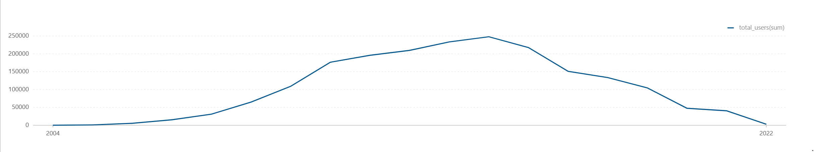
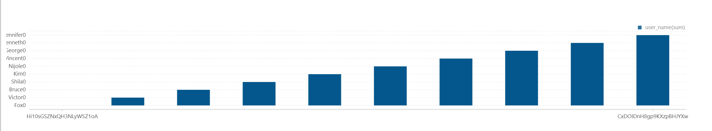
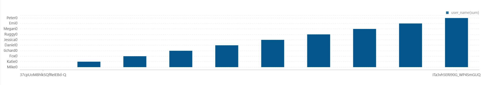
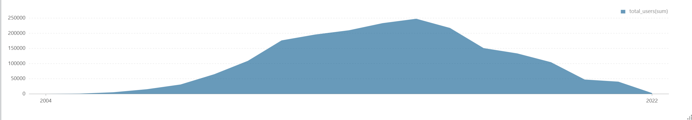
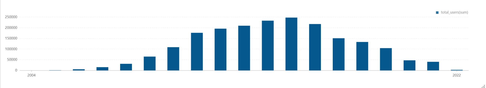
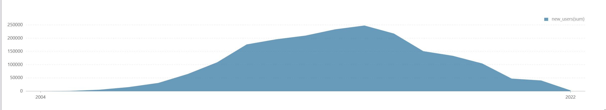
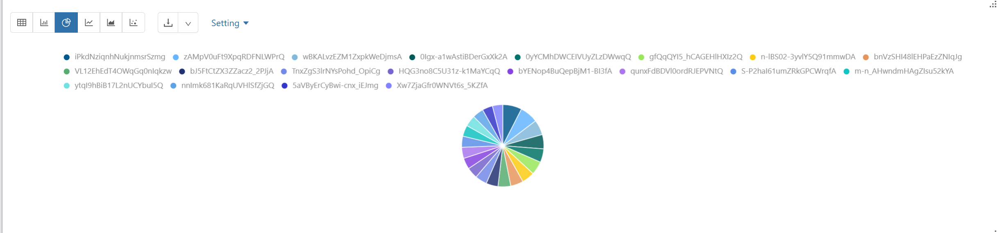
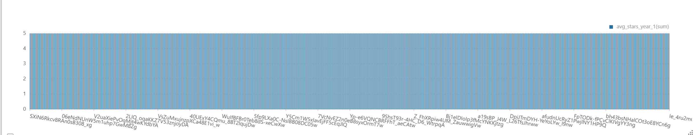
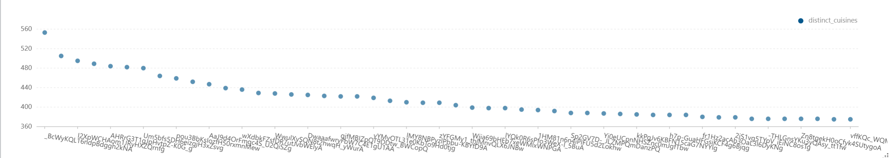
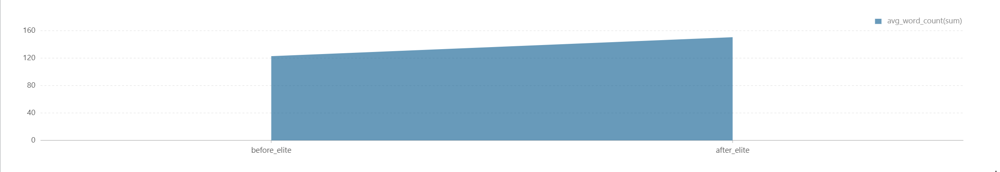

# User Analysis Report

Comprehensive analysis of Yelp user growth, influence, engagement behavior, and longitudinal contribution patterns.

## Executive Summary

This module studies **who contributes on Yelp, how they evolve, and how elite status changes behavior**. It combines yearly cohort metrics, influence rankings, activity segmentation, and preference diversity.

### Core Questions
- How fast does the user base grow over time?
- Who are the highest-impact reviewers and most-followed users?
- What share of users are elite vs. regular and active vs. silent?
- How do user ratings and contribution patterns evolve?
- Does elite status correlate with higher content depth and usefulness?

### Key Findings
- User onboarding starts with 90 users in 2004 and scales quickly (937 in 2005)
- Top reviewers exceed 16K+ lifetime reviews in the output sample
- Elite ratio is substantial in early years (30.0% in 2004; 42.8% in 2005)
- Elite-period behavior shows longer reviews and higher useful-vote averages (`10.Elite_Status_Impact.csv`)
- Dining diversity leaders cover 500+ distinct cuisine tags

---

## Table of Contents

1. [Business Hypothesis](#business-hypothesis)
2. [Data Sources](#data-sources)
3. [Methodology](#methodology)
4. [Analyses Overview](#analyses-overview)
5. [Analysis Details](#analysis-details)
6. [Files and References](#files-and-references)

---

## Business Hypothesis

### Problem Statement
Understanding user behavior is essential for community health and recommendation quality:
1. **Growth Planning** - Track acquisition and retention signals by year
2. **Influencer Discovery** - Identify high-impact contributors
3. **Community Governance** - Quantify elite/regular and active/silent structure
4. **Quality Control** - Measure rating drift and content usefulness patterns

### Hypotheses to Test
- **H1: Power-user concentration** - A small set of users contributes disproportionate review volume
- **H2: Elite behavior shift** - Elite recognition aligns with improved content depth/utility
- **H3: Preference breadth effect** - High-contribution users show broader cuisine diversity

---

## Data Sources

- Yelp user profiles (join dates, fans, elite flags)
- Yelp reviews (counts, stars, useful votes, text length proxies)
- Derived user-level and year-level aggregates in `results/data-analysis/user-analysis/csv/`

---

## Methodology

### Analysis Framework

1. **Population and cohort trends**
   - yearly user joins, annual aggregates, early-adopter profiling
2. **Influence and engagement structure**
   - top reviewers, most popular users, elite vs regular ratios
3. **Behavioral and quality evolution**
   - rating evolution, dining diversity, elite impact before/after

### Key Metrics

| Metric | Definition |
|--------|-----------|
| total_users | Number of users in the selected year/group |
| user_review_count | Lifetime reviews per user |
| elite_ratio | Share of elite users among yearly users |
| silent_ratio | Share of users with no activity in defined period |
| star_change | Difference between early and later average stars |
| distinct_cuisines | Number of unique cuisine types reviewed |

---

## Analyses Overview

1. `1.Number_of_Users_Joining.py`
2. `2.Top_Reviewers.py`
3. `3.Most_Popular_Users.py`
4. `4.Ratio_of_Elite_Users_to_Regular_Users.py`
5. `5.Proportion_of_Total_Users_and_Silent_Users.py`
6. `6.Yearly_Statistics.py`
7. `7.Early_Adopters.py`
8. `8.User_Rating_Evolution.py`
9. `9.Dining_Diversity.py`
10. `10.Elite_Status_Impact.py`

---

## Analysis Details

### 1) Number of Users Joining
- **Objective:** Track yearly user acquisition trend
- **Result file:** [`1.Number_of_Users_Joining.csv`](../../../results/data-analysis/user-analysis/csv/1.Number_of_Users_Joining.csv)
- **Graph:** [`1.Number_of_Users_Joining.png`](../../../results/data-analysis/user-analysis/graphs/1.Number_of_Users_Joining.png)
- **Script:** [`1.Number_of_Users_Joining.py`](1.Number_of_Users_Joining.py)

| year | total_users |
|------|-------------|
| 2004 | 90 |
| 2005 | 937 |

### 2) Top Reviewers
- **Objective:** Identify users with highest review output
- **Result file:** [`2.Top_Reviewers.csv`](../../../results/data-analysis/user-analysis/csv/2.Top_Reviewers.csv)
- **Graph:** [`2.Top_Reviewers.png`](../../../results/data-analysis/user-analysis/graphs/2.Top_Reviewers.png)
- **Script:** [`2.Top_Reviewers.py`](2.Top_Reviewers.py)

| user_id | user_name | user_review_count |
|---------|-----------|-------------------|
| Hi10sGSZNxQH3NLyWSZ1oA | Fox | 17473 |
| 8k3aO-mPeyhbR5HUucA5aA | Victor | 16978 |

### 3) Most Popular Users
- **Objective:** Rank users by fan count
- **Result file:** [`3.Most_Popular_Users.csv`](../../../results/data-analysis/user-analysis/csv/3.Most_Popular_Users.csv)
- **Graph:** [`3.Most_Popular_Users.png`](../../../results/data-analysis/user-analysis/graphs/3.Most_Popular_Users.png)
- **Script:** [`3.Most_Popular_Users.py`](3.Most_Popular_Users.py)

| user_id | user_name | user_fans |
|---------|-----------|-----------|
| 37cpUoM8hlkSQfReIEBd-Q | Mike | 12497 |
| hizGc5W1tBHPghM5YKCAtg | Katie | 3642 |

### 4) Ratio of Elite Users to Regular Users
- **Objective:** Measure yearly elite composition
- **Result file:** [`4.Ratio_of_Elite_Users_to_Regular_Users.csv`](../../../results/data-analysis/user-analysis/csv/4.Ratio_of_Elite_Users_to_Regular_Users.csv)
- **Graph:** [`4.Ratio_of_Elite_Users_to_Regular_Users.png`](../../../results/data-analysis/user-analysis/graphs/4.Ratio_of_Elite_Users_to_Regular_Users.png)
- **Script:** [`4.Ratio_of_Elite_Users_to_Regular_Users.py`](4.Ratio_of_Elite_Users_to_Regular_Users.py)

| year | total_users | elite_users | regular_users | elite_ratio |
|------|-------------|-------------|---------------|-------------|
| 2004 | 90 | 27 | 63 | 30.0 |
| 2005 | 937 | 401 | 536 | 42.8 |

### 5) Proportion of Total Users and Silent Users
- **Objective:** Separate active and silent user segments
- **Result file:** [`5.Proportion_of_Total_Users_and_Silent_Users.csv`](../../../results/data-analysis/user-analysis/csv/5.Proportion_of_Total_Users_and_Silent_Users.csv)
- **Graph:** [`5.Proportion_of_Total_Users_and_Silent_Users.png`](../../../results/data-analysis/user-analysis/graphs/5.Proportion_of_Total_Users_and_Silent_Users.png)
- **Script:** [`5.Proportion_of_Total_Users_and_Silent_Users.py`](5.Proportion_of_Total_Users_and_Silent_Users.py)

| year | total_users | silent_users | active_users | silent_ratio | active_ratio |
|------|-------------|--------------|--------------|--------------|--------------|
| 2004 | 90 | 0 | 90 | 0.0 | 100.0 |
| 2005 | 937 | 0 | 937 | 0.0 | 100.0 |

### 6) Yearly Statistics
- **Objective:** Build yearly summary table of user/review/elite/star metrics
- **Result file:** [`6.Yearly_Statistics.csv`](../../../results/data-analysis/user-analysis/csv/6.Yearly_Statistics.csv)
- **Graph:** [`6.Yearly_Statistics.png`](../../../results/data-analysis/user-analysis/graphs/6.Yearly_Statistics.png)
- **Script:** [`6.Yearly_Statistics.py`](6.Yearly_Statistics.py)

| year | new_users | total_reviews | elite_users | avg_reviews_per_user | avg_stars |
|------|-----------|---------------|-------------|----------------------|-----------|
| 2004 | 90 | 14577 | 27 | 161.97 | 3.644 |
| 2005 | 937 | 226005 | 401 | 241.20 | 3.817 |

### 7) Early Adopters
- **Objective:** Identify users with high early review activity
- **Result file:** [`7.Early_Adopters.csv`](../../../results/data-analysis/user-analysis/csv/7.Early_Adopters.csv)
- **Graph:** [`7.Early_Adopters.png`](../../../results/data-analysis/user-analysis/graphs/7.Early_Adopters.png)
- **Script:** [`7.Early_Adopters.py`](7.Early_Adopters.py)

| rev_user_id | early_review_count | user_id | user_name |
|-------------|--------------------|---------|-----------|
| iPkdNziqnhNukjnmsrSzmg | 24 | iPkdNziqnhNukjnmsrSzmg | Kelly |
| zAMpV0uFt9XpqRDFNLWPrQ | 23 | zAMpV0uFt9XpqRDFNLWPrQ | TOMMY |

### 8) User Rating Evolution
- **Objective:** Compare early vs later rating behavior per user
- **Result file:** [`8.User_Rating_Evolution.csv`](../../../results/data-analysis/user-analysis/csv/8.User_Rating_Evolution.csv)
- **Graph:** [`8.User_Rating_Evolution.png`](../../../results/data-analysis/user-analysis/graphs/8.User_Rating_Evolution.png)
- **Script:** [`8.User_Rating_Evolution.py`](8.User_Rating_Evolution.py)

| rev_user_id | avg_stars_year_1 | avg_stars_year_3 | star_change | user_id | user_name |
|-------------|------------------|------------------|-------------|---------|-----------|
| SXiN6Rkcv8RAn0sB308_xg | 5.0 | 1.0 | -4.0 | SXiN6Rkcv8RAn0sB308_xg | Joe |
| RNSMuwdio8aoAalSjGLE8w | 5.0 | 1.0 | -4.0 | RNSMuwdio8aoAalSjGLE8w | Megan |

### 9) Dining Diversity
- **Objective:** Measure breadth of cuisine exposure by user
- **Result file:** [`9.Dining_Diversity.csv`](../../../results/data-analysis/user-analysis/csv/9.Dining_Diversity.csv)
- **Graph:** [`9.Dining_Diversity.png`](../../../results/data-analysis/user-analysis/graphs/9.Dining_Diversity.png)
- **Script:** [`9.Dining_Diversity.py`](9.Dining_Diversity.py)

| rev_user_id | distinct_cuisines | total_reviews | user_id | user_name |
|-------------|-------------------|---------------|---------|-----------|
| _BcWyKQL16ndpBdggh2kNA | 553 | 14432 | _BcWyKQL16ndpBdggh2kNA | Karen |
| ET8n-r7glWYqZhuR6GcdNw | 505 | 8802 | ET8n-r7glWYqZhuR6GcdNw | Michelle |

### 10) Elite Status Impact
- **Objective:** Compare before-elite vs after-elite writing/usefulness behavior
- **Result file:** [`10.Elite_Status_Impact.csv`](../../../results/data-analysis/user-analysis/csv/10.Elite_Status_Impact.csv)
- **Graph:** [`10.Elite_Status_Impact.png`](../../../results/data-analysis/user-analysis/graphs/10.Elite_Status_Impact.png)
- **Script:** [`10.Elite_Status_Impact.py`](10.Elite_Status_Impact.py)

| status | avg_word_count | avg_useful_votes | total_reviews |
|--------|----------------|------------------|---------------|
| before_elite | 122.87 | 1.35 | 161150 |
| after_elite | 150.53 | 2.40 | 1564508 |

---

## Files and References

### Notebook
- [`User-Analysis.zpln`](../../../notebooks/data-analysis/user-analysis/User-Analysis.zpln)

### Output folders
- **CSV:** [`../../../results/data-analysis/user-analysis/csv/`](../../../results/data-analysis/user-analysis/csv/)
- **Graphs:** [`../../../results/data-analysis/user-analysis/graphs/`](../../../results/data-analysis/user-analysis/graphs/)

### Helper script
- [`load_all_table.py`](load_all_table.py)

---

**Last Updated**: March 2026  
**Tooling**: Apache Spark (PySpark)

