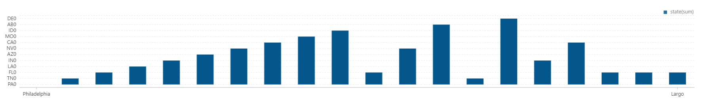
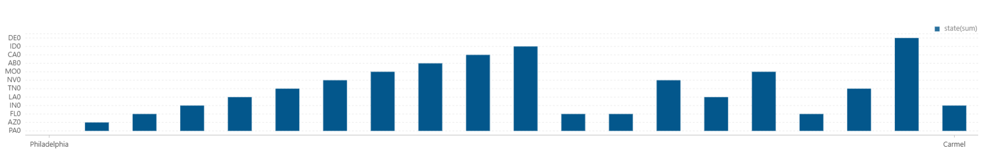
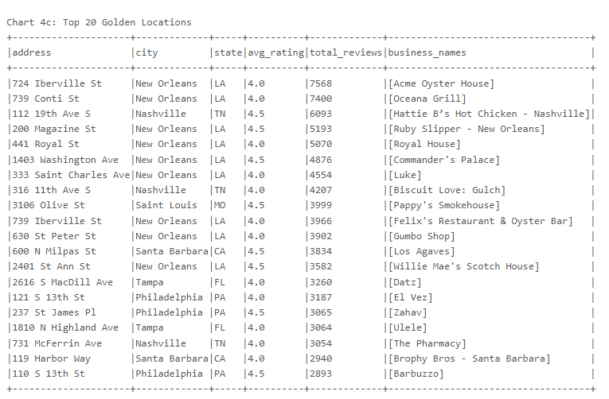
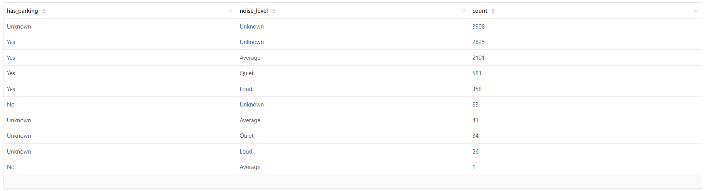
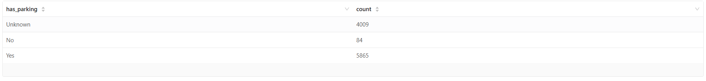

# Cursed Storefronts and Multi-Dimensional Attribution Report

Data enrichment analysis that identifies potentially "cursed" business locations and attributes risk using location quality, closures, attributes, and review text pain points.

## Executive Summary

This module combines Yelp business outcomes with enriched context (walkability proxies, closure patterns, parking/noise attributes, and NLP pain-point tags) to locate high-risk storefront environments.

### Core Questions
- Which places have strong vs weak location potential?
- Where are closure concentrations and cursed-location clusters?
- Which cities show the highest cursed storefront counts?
- What business attributes (parking/noise) correlate with cursed outcomes?
- Which customer pain points are most common in risky storefronts?

### Key Findings
- Business potential distribution outputs include `Excellent` and `Good` cohorts (`01_business_potential_distribution.csv`)
- Walkability enrichment separates areas like `Car-Dependent` and `Very Walkable`
- Cursed-level outputs identify both `POTENTIALLY CURSED` and `SEVERELY CURSED` storefront groups
- City leaderboard output shows large cursed-location totals in major metros (e.g., Philadelphia)
- Pain-point extraction highlights frequent complaint themes such as `Bad Location` and `Price Issues`

---

## Table of Contents

1. [Business Hypothesis](#business-hypothesis)
2. [Data Sources](#data-sources)
3. [Methodology](#methodology)
4. [Analyses Overview](#analyses-overview)
5. [Analysis Details](#analysis-details)
6. [Files and References](#files-and-references)

---

## Business Hypothesis

### Problem Statement
Location failure is multi-factorial and cannot be explained by one metric alone. Decision-makers need a joined risk model that integrates market context, operational attributes, and customer feedback.

### Hypotheses to Test
- **H1: Context hypothesis** - Low accessibility and weak area potential associate with higher closure risk
- **H2: Concentration hypothesis** - Cursed storefronts cluster in specific city zones
- **H3: Attribution hypothesis** - Parking/noise and text-derived pain points explain part of cursed-location outcomes

---

## Data Sources

- Yelp business records and open/closed indicators
- Yelp category and attribute fields (e.g., parking, noise level)
- Yelp review text for NLP pain-point extraction
- Enriched location context used by the external data pipeline

---

## Methodology

### Analysis Framework

1. **External data enrichment and potential scoring**
2. **Lifecycle and cursed-level classification**
3. **Golden location identification and city ranking**
4. **Attribute interaction analysis (parking/noise)**
5. **NLP-based pain-point distribution profiling**

### Key Output Families

| Output Family | Purpose |
|--------------|---------|
| Potential & Walkability | Segment businesses by contextual location strength |
| Cursed Level & Failure Rate | Quantify closure-risk intensity |
| Golden Locations | Find cities and locations with favorable performance |
| Attribute Patterns | Explore parking/noise structure in cursed vs broader sets |
| Pain Points | Prioritize recurring customer complaints |

---

## Analyses Overview

1. `01_external_data_enrichment.py`
2. `02_lifecycle_analysis.py`
3. `03_Golden_Location_Analysis.py`
4. `04_Attribute_Analysis.py`
5. `05_NLP_Pain_Point_Analysis.py`

---

## Analysis Details

### 1) External Data Enrichment
- **Script:** [`01_external_data_enrichment.py`](01_external_data_enrichment.py)
- **CSV outputs:**
  - [`01_business_potential_distribution.csv`](../../../results/data-enrichment/Cursed_Storefronts_&_Multi-Dimentional_Attribution/csv/01_business_potential_distribution.csv)
  - [`01_walk_score_categories_distribution.csv`](../../../results/data-enrichment/Cursed_Storefronts_&_Multi-Dimentional_Attribution/csv/01_walk_score_categories_distribution.csv)
- **Graphs:**
  - [`01_Business_Potential_Distribution.png`](../../../results/data-enrichment/Cursed_Storefronts_&_Multi-Dimentional_Attribution/graphs/01_Business_Potential_Distribution.png)
  - [`01_Walk_Score_Categories_Distribution.png`](../../../results/data-enrichment/Cursed_Storefronts_&_Multi-Dimentional_Attribution/graphs/01_Walk_Score_Categories_Distribution.png)

**CSV preview: `01_business_potential_distribution.csv`**

| business_potential | count |
|--------------------|-------|
| Excellent | 1112 |
| Good | 3266 |

**CSV preview: `01_walk_score_categories_distribution.csv`**

| walkability_category | count |
|----------------------|-------|
| Car-Dependent | 3630 |
| Very Walkable | 1112 |

### 2) Lifecycle Analysis
- **Script:** [`02_lifecycle_analysis.py`](02_lifecycle_analysis.py)
- **CSV outputs:**
  - [`02_Cursed_Level_Distribution.csv`](../../../results/data-enrichment/Cursed_Storefronts_&_Multi-Dimentional_Attribution/csv/02_Cursed_Level_Distribution.csv)
  - [`02_Failure_Rate_Distribution.csv`](../../../results/data-enrichment/Cursed_Storefronts_&_Multi-Dimentional_Attribution/csv/02_Failure_Rate_Distribution.csv)
  - [`02_Top_20_Most_Cursed_Cities.csv`](../../../results/data-enrichment/Cursed_Storefronts_&_Multi-Dimentional_Attribution/csv/02_Top_20_Most_Cursed_Cities.csv)
- **Graphs:**
  - [`02_Cursed_Level_Distribution.png`](../../../results/data-enrichment/Cursed_Storefronts_&_Multi-Dimentional_Attribution/graphs/02_Cursed_Level_Distribution.png)
  - [`02_Failure_Rate_Distribution.png`](../../../results/data-enrichment/Cursed_Storefronts_&_Multi-Dimentional_Attribution/graphs/02_Failure_Rate_Distribution.png)
  - [`02_Top_20_Most_Cursed_Cities.png`](../../../results/data-enrichment/Cursed_Storefronts_&_Multi-Dimentional_Attribution/graphs/02_Top_20_Most_Cursed_Cities.png)

**CSV preview: `02_Cursed_Level_Distribution.csv`**

| cursed_level | count |
|--------------|-------|
| POTENTIALLY CURSED | 1266 |
| SEVERELY CURSED | 127 |

**CSV preview: `02_Failure_Rate_Distribution.csv`**

| failure_rate_bin | count |
|------------------|-------|
| 0-20% | 117 |
| 20-40% | 171 |

**CSV preview: `02_Top_20_Most_Cursed_Cities.csv`**

| city | state | cursed_count | total_closures |
|------|-------|--------------|----------------|
| Philadelphia | PA | 398 | 646 |
| Nashville | TN | 146 | 216 |

### 3) Golden Location Analysis
- **Script:** [`03_Golden_Location_Analysis.py`](03_Golden_Location_Analysis.py)
- **CSV outputs:**
  - [`03_Rating_Distribution.csv`](../../../results/data-enrichment/Cursed_Storefronts_&_Multi-Dimentional_Attribution/csv/03_Rating_Distribution.csv)
  - [`03_Top_20_Cities_with_Golden_Locations.csv`](../../../results/data-enrichment/Cursed_Storefronts_&_Multi-Dimentional_Attribution/csv/03_Top_20_Cities_with_Golden_Locations.csv)
- **Graphs:**
  - [`03_Rating_Distribution.png`](../../../results/data-enrichment/Cursed_Storefronts_&_Multi-Dimentional_Attribution/graphs/03_Rating_Distribution.png)
  - [`03_Top_20_Cities_with_Golden_Locations.png`](../../../results/data-enrichment/Cursed_Storefronts_&_Multi-Dimentional_Attribution/graphs/03_Top_20_Cities_with_Golden_Locations.png)
  - [`03_Top_20_Golden_Locations.png`](../../../results/data-enrichment/Cursed_Storefronts_&_Multi-Dimentional_Attribution/graphs/03_Top_20_Golden_Locations.png)

**CSV preview: `03_Rating_Distribution.csv`**

| avg_rating | count |
|------------|-------|
| 4.0 | 21049 |
| 4.5 | 19357 |

**CSV preview: `03_Top_20_Cities_with_Golden_Locations.csv`**

| city | state | golden_count |
|------|-------|--------------|
| Philadelphia | PA | 4549 |
| Tucson | AZ | 3153 |

### 4) Attribute Analysis
- **Script:** [`04_Attribute_Analysis.py`](04_Attribute_Analysis.py)
- **CSV outputs:**
  - [`04_Attribute_Patterns_Parking_vs_Noise_Level.csv`](../../../results/data-enrichment/Cursed_Storefronts_&_Multi-Dimentional_Attribution/csv/04_Attribute_Patterns_Parking_vs_Noise_Level.csv)
  - [`04_Noise_Level_in_Cursed_Locations.csv`](../../../results/data-enrichment/Cursed_Storefronts_&_Multi-Dimentional_Attribution/csv/04_Noise_Level_in_Cursed_Locations.csv)
  - [`04_Parking_Availability_in_Cursed_Locations.csv`](../../../results/data-enrichment/Cursed_Storefronts_&_Multi-Dimentional_Attribution/csv/04_Parking_Availability_in_Cursed_Locations.csv)
- **Graphs:**
  - [`04_Attribute_Patterns_Parking_vs_Noise_Level.png`](../../../results/data-enrichment/Cursed_Storefronts_&_Multi-Dimentional_Attribution/graphs/04_Attribute_Patterns_Parking_vs_Noise_Level.png)
  - [`04_Noise_Level_in_Cursed_Locations.png`](../../../results/data-enrichment/Cursed_Storefronts_&_Multi-Dimentional_Attribution/graphs/04_Noise_Level_in_Cursed_Locations.png)
  - [`04_Parking_Availability_in_Cursed_Locations.png`](../../../results/data-enrichment/Cursed_Storefronts_&_Multi-Dimentional_Attribution/graphs/04_Parking_Availability_in_Cursed_Locations.png)

**CSV preview: `04_Attribute_Patterns_Parking_vs_Noise_Level.csv`**

| has_parking | noise_level | count |
|-------------|-------------|-------|
| Unknown | Unknown | 3908 |
| Yes | Unknown | 2825 |

**CSV preview: `04_Noise_Level_in_Cursed_Locations.csv`**

| noise_level | count |
|-------------|-------|
| Loud | 384 |
| Average | 2143 |

**CSV preview: `04_Parking_Availability_in_Cursed_Locations.csv`**

| has_parking | count |
|-------------|-------|
| Unknown | 4009 |
| No | 84 |

### 5) NLP Pain Point Analysis
- **Script:** [`05_NLP_Pain_Point_Analysis.py`](05_NLP_Pain_Point_Analysis.py)
- **CSV output:** [`05_Pain_Point_Distribution.csv`](../../../results/data-enrichment/Cursed_Storefronts_&_Multi-Dimentional_Attribution/csv/05_Pain_Point_Distribution.csv)
- **Graph:** [`05_Pain_Point_Distribution.png`](../../../results/data-enrichment/Cursed_Storefronts_&_Multi-Dimentional_Attribution/graphs/05_Pain_Point_Distribution.png)

| Pain_Point | Count |
|------------|-------|
| Bad Location | 22413 |
| Price Issues | 10646 |

---

## Files and References

### Notebook
- [`Cursed_Storefronts_and_MDA.zpln`](../../../notebooks/data-enrichment/Cursed_Storefronts_and_MDA.zpln)

### Output folders
- **CSV:** [`../../../results/data-enrichment/Cursed_Storefronts_&_Multi-Dimentional_Attribution/csv/`](../../../results/data-enrichment/Cursed_Storefronts_&_Multi-Dimentional_Attribution/csv/)
- **Graphs:** [`../../../results/data-enrichment/Cursed_Storefronts_&_Multi-Dimentional_Attribution/graphs/`](../../../results/data-enrichment/Cursed_Storefronts_&_Multi-Dimentional_Attribution/graphs/)

---

**Last Updated**: March 2026  
**Tooling**: Apache Spark (PySpark)

