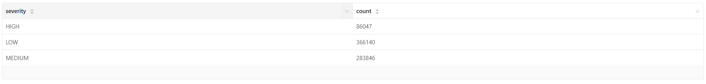
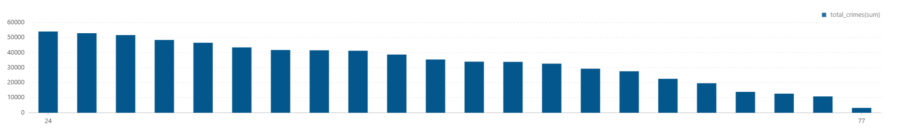
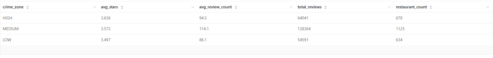
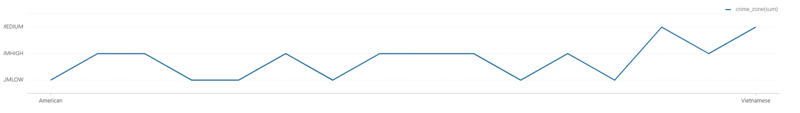
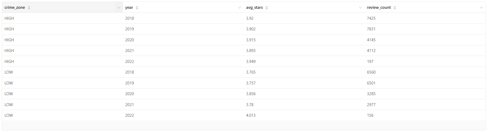
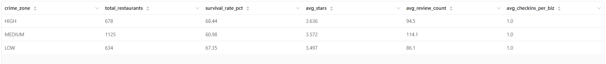

# Open World Data Enrichment Report

Crime-enriched restaurant analysis that links district-level public safety signals to restaurant distribution, survival, ratings, cuisine mix, and engagement.

## Executive Summary

This module integrates Yelp business outcomes with crime-zone context to examine whether dining performance changes across high/medium/unknown risk zones.

### Core Questions
- How are crime severities distributed across districts?
- How many restaurants operate in each crime zone?
- Does survival rate differ by crime zone?
- How do average ratings and review volume vary across zones?
- Do cuisine mix and check-in volume shift with safety context?

### Key Findings
- Crime records include both HIGH and LOW severity classes (`01_crime_severity_distribution.csv`)
- District crime-zone classification is produced with total and high-severity counts (`02_crime_zone_per_district.csv`)
- Restaurant survival differs by zone in the generated output (e.g., HIGH: 68.44%, MEDIUM: 60.98%)
- Zone-level rating/review/check-in tables are available for cross-metric comparison
- Correlation-ready summary table consolidates zone outcomes (`09_crime-dining_correlation.csv`)

---

## Table of Contents

1. [Business Hypothesis](#business-hypothesis)
2. [Data Sources](#data-sources)
3. [Methodology](#methodology)
4. [Analyses Overview](#analyses-overview)
5. [Analysis Details](#analysis-details)
6. [Files and References](#files-and-references)

---

## Business Hypothesis

### Problem Statement
Restaurant planning and risk management benefit from external context beyond internal ratings/reviews. Crime exposure may influence operating stability and customer behavior.

### Hypotheses to Test
- **H1: Exposure hypothesis** - Restaurant survival varies by crime-zone intensity
- **H2: Perception hypothesis** - Ratings and review patterns differ across zones
- **H3: Portfolio hypothesis** - Cuisine presence and engagement mix shift with crime context

---

## Data Sources

- Open-world crime records with district and severity metadata
- Yelp business/review/check-in aggregates
- Enriched mapping between restaurants and district crime zones

---

## Methodology

### Analysis Framework

1. Build district-level crime severity structure
2. Assign crime-zone labels for downstream joins
3. Aggregate restaurant count/survival/rating/check-in metrics by zone
4. Compare cuisine composition and yearly trend behavior by zone
5. Produce compact correlation input table

### Key Metrics

| Metric | Definition |
|--------|-----------|
| crime_zone | Zone label from district crime profile |
| survival_rate_pct | Open restaurants / total restaurants by zone |
| avg_stars | Mean star rating by zone |
| avg_review_count | Mean reviews per restaurant by zone |
| avg_checkins_per_biz | Mean check-in volume per business by zone |

---

## Analyses Overview

1. `01_crime_severity_distribution.py`
2. `02_crime_zone_per_district.py`
3. `03_restaurants_per_crime_zone.py`
4. `04_restaurant_survival_rate_by_crime _zone.py`
5. `05_average_ratings_by_crime_zone.py`
6. `06_cuisine_distribution_by_crime_zone.py`
7. `07_yearly_rating_trend_by_crime_zone.py`
8. `08_checkin _volume_by_crime_zone.py`
9. `09_crime-dining_correlation.py`

---

## Analysis Details

### 1) Crime Severity Distribution
- **Script:** [`01_crime_severity_distribution.py`](01_crime_severity_distribution.py)
- **CSV:** [`01_crime_severity_distribution.csv`](../../../results/data-enrichment/open-world-data-safari/csv/01_crime_severity_distribution.csv)
- **Graph:** [`01_crime_severity_distribution.png`](../../../results/data-enrichment/open-world-data-safari/graphs/01_crime_severity_distribution.png)

| severity | count |
|----------|-------|
| HIGH | 86047 |
| LOW | 366140 |

### 2) Crime Zone per District
- **Script:** [`02_crime_zone_per_district.py`](02_crime_zone_per_district.py)
- **CSV:** [`02_crime_zone_per_district.csv`](../../../results/data-enrichment/open-world-data-safari/csv/02_crime_zone_per_district.csv)
- **Graph:** [`02_crime_zone_per_district.png`](../../../results/data-enrichment/open-world-data-safari/graphs/02_crime_zone_per_district.png)

| dc_dist | total_crimes | high_severity_count | crime_zone |
|---------|--------------|---------------------|------------|
| 24 | 54050 | 7441 | HIGH |
| 15 | 52924 | 6643 | HIGH |

### 3) Restaurants per Crime Zone
- **Script:** [`03_restaurants_per_crime_zone.py`](03_restaurants_per_crime_zone.py)
- **CSV:** [`03_restaurants_per_crime_zone.csv`](../../../results/data-enrichment/open-world-data-safari/csv/03_restaurants_per_crime_zone.csv)
- **Graph:** [`03_restaurants_per_crime_zone.png`](../../../results/data-enrichment/open-world-data-safari/graphs/03_restaurants_per_crime_zone.png)

| crime_zone | count |
|------------|-------|
| HIGH | 678 |
| UNKNOWN | 3567 |

### 4) Restaurant Survival Rate by Crime Zone
- **Script:** [`04_restaurant_survival_rate_by_crime _zone.py`](04_restaurant_survival_rate_by_crime%20_zone.py)
- **CSV:** [`04_restaurant_survival_rate_by_crime _zone.csv`](../../../results/data-enrichment/open-world-data-safari/csv/04_restaurant_survival_rate_by_crime%20_zone.csv)
- **Graph:** [`04_restaurant_survival_rate_by_crime _zone.png`](../../../results/data-enrichment/open-world-data-safari/graphs/04_restaurant_survival_rate_by_crime%20_zone.png)

| crime_zone | total_restaurants | open_restaurants | survival_rate_pct | closed_restaurants |
|------------|-------------------|------------------|-------------------|--------------------|
| HIGH | 678 | 464 | 68.44 | 214 |
| MEDIUM | 1125 | 686 | 60.98 | 439 |

### 5) Average Ratings by Crime Zone
- **Script:** [`05_average_ratings_by_crime_zone.py`](05_average_ratings_by_crime_zone.py)
- **CSV:** [`05_average_ratings_by_crime_zone.csv`](../../../results/data-enrichment/open-world-data-safari/csv/05_average_ratings_by_crime_zone.csv)
- **Graph:** [`05_average_ratings_by_crime_zone.png`](../../../results/data-enrichment/open-world-data-safari/graphs/05_average_ratings_by_crime_zone.png)

| crime_zone | avg_stars | avg_review_count | total_reviews | restaurant_count |
|------------|-----------|------------------|---------------|------------------|
| HIGH | 3.636 | 94.5 | 64041 | 678 |
| MEDIUM | 3.572 | 114.1 | 128364 | 1125 |

### 6) Cuisine Distribution by Crime Zone
- **Script:** [`06_cuisine_distribution_by_crime_zone.py`](06_cuisine_distribution_by_crime_zone.py)
- **CSV:** [`06_cuisine_distribution_by_crime_zone.csv`](../../../results/data-enrichment/open-world-data-safari/csv/06_cuisine_distribution_by_crime_zone.csv)
- **Graph:** [`06_cuisine_distribution_by_crime_zone.png`](../../../results/data-enrichment/open-world-data-safari/graphs/06_cuisine_distribution_by_crime_zone.png)

| cuisine | crime_zone | restaurant_count | avg_stars |
|---------|------------|------------------|-----------|
| American | MEDIUM | 243 | 3.582 |
| Pizza | MEDIUM | 164 | 3.335 |

### 7) Yearly Rating Trend by Crime Zone
- **Script:** [`07_yearly_rating_trend_by_crime_zone.py`](07_yearly_rating_trend_by_crime_zone.py)
- **CSV:** [`07_yearly_rating_trend_by_crime_zone.csv`](../../../results/data-enrichment/open-world-data-safari/csv/07_yearly_rating_trend_by_crime_zone.csv)
- **Graph:** [`07_yearly_rating_trend_by_crime_zone.png`](../../../results/data-enrichment/open-world-data-safari/graphs/07_yearly_rating_trend_by_crime_zone.png)

| crime_zone | year | avg_stars | review_count |
|------------|------|-----------|--------------|
| HIGH | 2018 | 3.920 | 7425 |
| HIGH | 2019 | 3.902 | 7831 |

### 8) Check-in Volume by Crime Zone
- **Script:** [`08_checkin _volume_by_crime_zone.py`](08_checkin%20_volume_by_crime_zone.py)
- **CSV:** [`08_checkin _volume_by_crime_zone.csv`](../../../results/data-enrichment/open-world-data-safari/csv/08_checkin%20_volume_by_crime_zone.csv)
- **Graph:** [`08_checkin _volume_by_crime_zone.png`](../../../results/data-enrichment/open-world-data-safari/graphs/08_checkin%20_volume_by_crime_zone.png)

| crime_zone | avg_checkins_per_biz | total_checkins | business_count |
|------------|----------------------|----------------|----------------|
| HIGH | 1.0 | 658 | 658 |
| MEDIUM | 1.0 | 1092 | 1092 |

### 9) Crime-Dining Correlation
- **Script:** [`09_crime-dining_correlation.py`](09_crime-dining_correlation.py)
- **CSV:** [`09_crime-dining_correlation.csv`](../../../results/data-enrichment/open-world-data-safari/csv/09_crime-dining_correlation.csv)
- **Graph:** [`09_crime-dining_correlation.png`](../../../results/data-enrichment/open-world-data-safari/graphs/09_crime-dining_correlation.png)

| crime_zone | total_restaurants | survival_rate_pct | avg_stars | avg_review_count | avg_checkins_per_biz |
|------------|-------------------|-------------------|-----------|------------------|----------------------|
| HIGH | 678 | 68.44 | 3.636 | 94.5 | 1.0 |
| MEDIUM | 1125 | 60.98 | 3.572 | 114.1 | 1.0 |

---

## Files and References

### Notebook
- [`open-world-data-safari.zpln`](../../../notebooks/data-enrichment/open-world-data-safari.zpln)

### Output folders
- **CSV:** [`../../../results/data-enrichment/open-world-data-safari/csv/`](../../../results/data-enrichment/open-world-data-safari/csv/)
- **Graphs:** [`../../../results/data-enrichment/open-world-data-safari/graphs/`](../../../results/data-enrichment/open-world-data-safari/graphs/)

---

**Last Updated**: March 2026  
**Tooling**: Apache Spark (PySpark)

