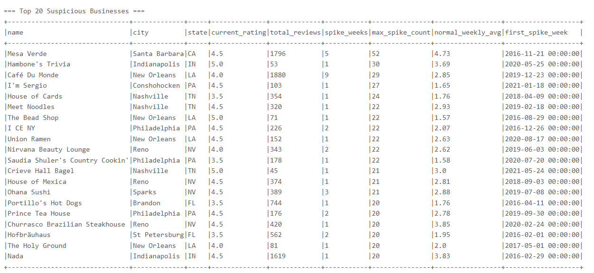
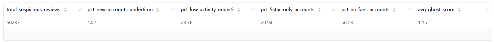
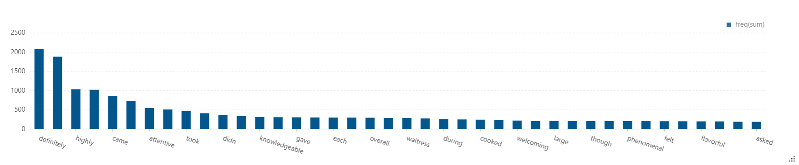

# Review Manipulation Syndicate Analysis

## Executive Summary

This analysis investigates suspicious reputation patterns by combining temporal spike detection, ghost-account behavioral signals, and NLP vocabulary analysis of high-risk reviews.

### Core Questions
- Which businesses show anomalous spikes in 5-star reviews?
- Do spike-linked reviews show ghost-account characteristics?
- What language patterns appear most frequently in high-risk review text?

### Key Findings
- 260 suspicious businesses are flagged by spike logic (`5x` weekly uplift and at least 10 weekly 5-star reviews).
- Top spike outliers include Mesa Verde (max weekly spike: 52) and Cafe Du Monde (29).
- Across 60,237 suspicious reviews, ghost indicators are substantial:
  - 14.70% from accounts younger than 6 months
  - 23.76% from low-activity accounts (5 or fewer reviews)
  - 20.94% from near-5-star-only profiles
  - 56.03% from accounts with zero fans
- Fraud-linked text is dominated by persuasive positive phrasing, with top tokens including definitely (2,083), recommend (1,883), highly (1,036), and attentive (549).

---

## Table of Contents

1. [Business Hypothesis](#business-hypothesis)
2. [Data Sources](#data-sources)
3. [Methodology](#methodology)
4. [Analyses Overview](#analyses-overview)
5. [Key Findings](#key-findings)
6. [Analysis Details](#analysis-details)
7. [Actionable Recommendations](#actionable-recommendations)
8. [Files and Visualizations](#files-and-visualizations)

---

## Business Hypothesis

### Problem Statement
Review inflation can distort trust, ranking, and conversion. If synthetic or coordinated behavior is present, it should be detectable in timing patterns, reviewer metadata, and repeated language signatures.

### Hypothesis Components

**H1: Temporal Manipulation Hypothesis**
- Manipulated businesses exhibit abrupt weekly 5-star surges well above baseline.

**H2: Ghost Account Hypothesis**
- Spike periods disproportionately involve newly created, low-activity, no-fan, near-5-star-only reviewer profiles.

**H3: Vocabulary Signature Hypothesis**
- High-risk review text contains repeated persuasive lexical patterns that are atypical in organic review distributions.

---

## Data Sources

### Internal Data (Yelp)
- Business table:
  - Fields used: business_id, name, city, state, stars, review_count
- Review table:
  - Fields used: business_id, user_id, date, stars, text
- Users table:
  - Fields used: user_id, name, review_count, yelping_since, fans, average_stars

### Time Granularity
- Temporal anomaly detection is computed at weekly level using `date_trunc('week', date)`.

---

## Methodology

### Analysis 1: Suspicious 5-Star Spike Detection
1. Filter reviews to 5-star only.
2. Aggregate weekly 5-star counts per business.
3. Compute each business baseline weekly average.
4. Flag spike week where:
   - weekly_5star_count >= 5 * avg_weekly_5star
   - avg_weekly_5star >= 1
   - weekly_5star_count >= 10
5. Rank suspicious businesses by max spike magnitude.

### Analysis 2a: Ghost Account Behavior Analysis
1. Rebuild suspicious business IDs from spike logic.
2. Join suspicious 5-star reviews with user metadata.
3. Compute per-review ghost indicators:
   - New account (<= 180 days old at review time)
   - Low activity (<= 5 total reviews)
   - Five-star-only tendency (average_stars >= 4.8)
   - No fans (fans == 0)
4. Sum indicators into ghost_score.
5. Aggregate global rates and business-level concentrations.

### Analysis 2b: Fraudulent Review Text Analysis
1. Restrict to ghost_score >= 3 review records.
2. Clean text and tokenize.
3. Build stopword set including common English stopwords and business-name words.
4. Aggregate token frequencies and rank top suspicious vocabulary.

---

## Analyses Overview

### Analysis 1: Anomaly Detection
- Output: suspicious businesses with spike statistics and first spike timestamp.

### Analysis 2a: Account-Level Forensics
- Output: ghost-behavior prevalence metrics and high ghost-concentration business list.

### Analysis 2b: Textual Forensics
- Output: high-frequency suspicious tokens from high ghost-score reviews.

---

## Key Findings

### Finding 1: 5-Star Spikes Are Concentrated in a Distinct Set of Businesses

- Output size: 260 suspicious businesses (261 CSV lines including header).
- Top outliers by max spike count:

| Business | City | State | Max Spike | Spike Weeks | Normal Weekly Avg |
|---|---|---|---:|---:|---:|
| Mesa Verde | Santa Barbara | CA | 52 | 5 | 4.73 |
| Hambone's Trivia | Indianapolis | IN | 30 | 1 | 3.69 |
| Cafe Du Monde | New Orleans | LA | 29 | 9 | 2.85 |
| I'm Sergio | Conshohocken | PA | 27 | 1 | 1.65 |
| House of Cards | Nashville | TN | 24 | 1 | 1.76 |

Interpretation:
- Some businesses exhibit repeated spikes (not one-off), suggesting non-random temporal anomalies.

### Finding 2: Ghost Indicators Are Material in Suspicious Reviews

| Metric | Value |
|---|---:|
| Total Suspicious Reviews | 60,237 |
| % New Accounts (< 6 months) | 14.70% |
| % Low Activity (<= 5 reviews) | 23.76% |
| % Near-5-Star-Only Accounts | 20.94% |
| % No-Fan Accounts | 56.03% |
| Average Ghost Score | 1.15 |

Interpretation:
- The no-fan ratio is especially high, and combined ghost signals indicate measurable synthetic-risk pressure.

### Finding 3: Fraud-Linked Vocabulary Is Repetitive and Persuasive

Top words from high ghost-score reviews:

| Word | Frequency |
|---|---:|
| definitely | 2,083 |
| recommend | 1,883 |
| highly | 1,036 |
| server | 1,022 |
| came | 859 |
| ordered | 729 |
| attentive | 549 |
| while | 509 |
| took | 470 |
| enjoyed | 412 |

Interpretation:
- Repetition of strong endorsement words supports the lexical-signature hypothesis for manipulation screening.

---

## Analysis Details

### Analysis 1: Suspicious Five-Star Spike Detection
**File**: [1_Suspicious_Five_Star_Spike_Detection.csv](../../../results/data-enrichment/review_manipulation/csv/1_Suspicious_Five_Star_Spike_Detection.csv)
**Visualization**: [1_Suspicious_Five_Star_Spike_Detection.png](../../../results/data-enrichment/review_manipulation/graphs/1_Suspicious_Five_Star_Spike_Detection.png)

### Analysis 2a: Ghost Account Behavior Analysis
**File**: [2a_Ghost_Account_Behavior_Analysis.csv](../../../results/data-enrichment/review_manipulation/csv/2a_Ghost_Account_Behavior_Analysis.csv)
**Visualization**: [2a_Ghost_Account_Behavior_Analysis.png](../../../results/data-enrichment/review_manipulation/graphs/2a_Ghost_Account_Behavior_Analysis.png)

### Analysis 2b: Fraudulent Review Text Analysis
**File**: [2b_Fraudulent_Review_Text_Analysis.csv](../../../results/data-enrichment/review_manipulation/csv/2b_Fraudulent_Review_Text_Analysis.csv)
**Visualization**: [2b_Fraudulent_Review_Text_Analysis.png](../../../results/data-enrichment/review_manipulation/graphs/2b_Fraudulent_Review_Text_Analysis.png)

---

## Actionable Recommendations

1. Build an automated risk score combining spike severity, ghost-score prevalence, and lexical anomaly rates.
2. Trigger manual moderation when a business crosses combined threshold bands.
3. Add cooldown monitoring after first spike week to detect repeated bursts.
4. Prioritize audits for businesses with repeated spikes and high ghost-review concentration.
5. Expand NLP from unigram frequency to phrase-level and semantic similarity checks.

---

## Files and Visualizations

### Source Code
- [1_Suspicious_Five_Star_Spike_Detection.py](1_Suspicious_Five_Star_Spike_Detection.py)
- [2a_Ghost_Account_Behavior_Analysis.py](2a_Ghost_Account_Behavior_Analysis.py)
- [2b_Fraudulent_Review_Text_Analysis.py](2b_Fraudulent_Review_Text_Analysis.py)

### Notebook
- [review_manipulation.zpln](../../../notebooks/data-enrichment/review_manipulation.zpln)

### Result Directories
- CSV: [../../../results/data-enrichment/review_manipulation/csv/](../../../results/data-enrichment/review_manipulation/csv/)
- Graphs: [../../../results/data-enrichment/review_manipulation/graphs/](../../../results/data-enrichment/review_manipulation/graphs/)

---

**Last Updated**: March 2026
**Data Period**: Yelp historical reviews and user profiles
**Analysis Tool**: Apache Spark (PySpark)
